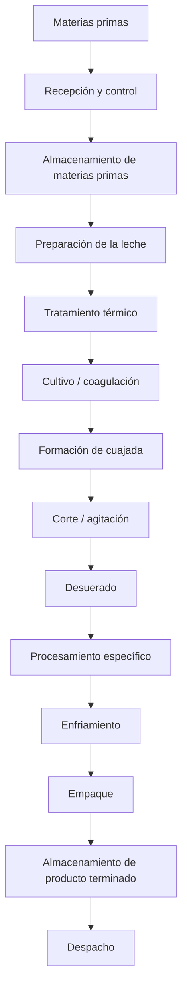
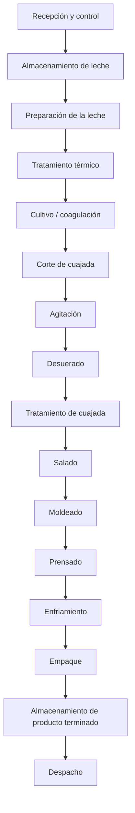
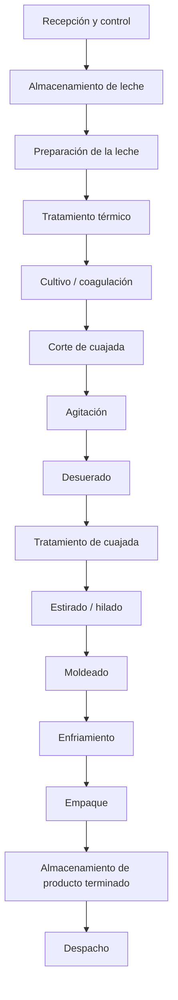
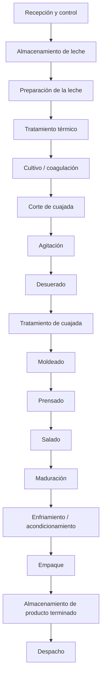
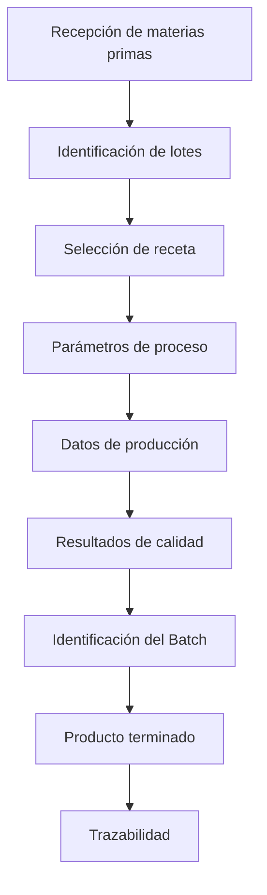
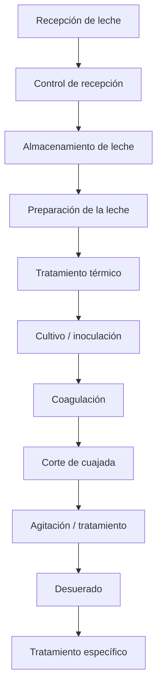
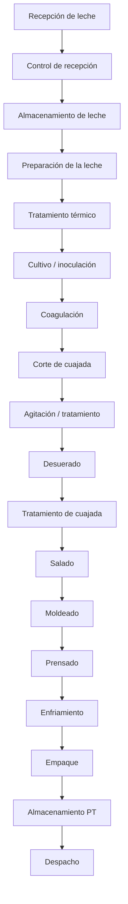
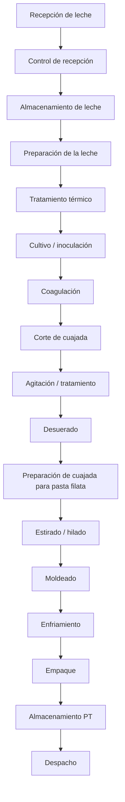
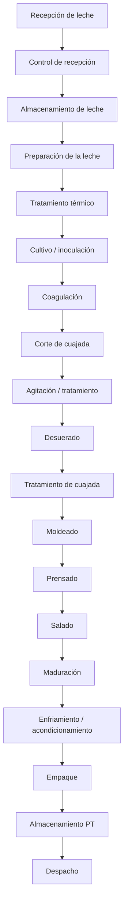
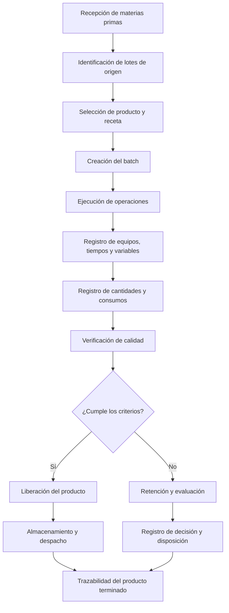

# Línea de Quesos — Modelo TDI

## Información general

**Proyecto:** Transformación Digital Industrial (TDI)
**Empresa de referencia:** Alpina Productos Alimenticios S.A.S.
**Planta de referencia:** Sopó, Cundinamarca, Colombia
**Línea:** Quesos
**Código de línea:** `Q`

> **Nota:** La planta de Sopó se utiliza como referencia del modelo académico. La información interna de Alpina que no sea públicamente verificable no se presenta como dato real de la empresa. En esos casos se utilizarán las etiquetas `REFERENCE`, `ASSUMED`, `CALCULATED` o `PROPOSED`.

---

# Estructura de modelamiento

La línea de quesos se desarrollará utilizando las 12 capas definidas en el estándar general del proyecto:

| Capa | Descripción            | Estado           |
| ---- | ---------------------- | ---------------- |
| 1    | Contexto               | 🟢 En desarrollo |
| 2    | Materias primas        | 🟢 En desarrollo |
| 3    | Flujo general          | ⚪ Pendiente      |
| 4    | Proceso detallado      | ⚪ Pendiente      |
| 5    | Equipos                | ⚪ Pendiente      |
| 6    | Variables              | ⚪ Pendiente      |
| 7    | Sensores y actuadores  | ⚪ Pendiente      |
| 8    | Tiempos                | ⚪ Pendiente      |
| 9    | Capacidades            | ⚪ Pendiente      |
| 10   | Recursos               | ⚪ Pendiente      |
| 11   | Recetas                | ⚪ Pendiente      |
| 12   | Batches y trazabilidad | ⚪ Pendiente      |

---

# Convenciones

## Origen de los datos

Todos los datos deben identificarse mediante una de las siguientes etiquetas:

| Etiqueta     | Significado                                              |
| ------------ | -------------------------------------------------------- |
| `PUBLIC`     | Información pública verificable de la empresa            |
| `REFERENCE`  | Información proveniente de literatura o fuentes técnicas |
| `ASSUMED`    | Supuesto establecido para el modelo académico            |
| `CALCULATED` | Resultado obtenido mediante cálculo                      |
| `PROPOSED`   | Elemento propuesto por el proyecto                       |

### Regla

> Ningún dato numérico debe aparecer sin indicar unidad + origen/estado.

Ejemplo:

```text
Temperatura de pasteurización: 72 °C — REFERENCE
Capacidad del lote: 500 kg/lote — ASSUMED
Producción diaria: 3.000 kg/día — CALCULATED
```

---

## Sistema de identificación

Todos los elementos de la línea de quesos utilizan el prefijo `Q`.

| Elemento          | Código      |
| ----------------- | ----------- |
| Producto          | `Q-PRD-XXX` |
| Operación         | `Q-OP-XXX`  |
| Equipo            | `Q-EQ-XXX`  |
| Variable          | `Q-VAR-XXX` |
| Sensor            | `Q-SEN-XXX` |
| Actuador          | `Q-ACT-XXX` |
| Receta            | `Q-REC-XXX` |
| Recurso           | `Q-RES-XXX` |
| Materia prima     | `Q-MP-XXX`  |
| Material auxiliar | `Q-MA-XXX`  |

Los elementos compartidos de planta utilizarán el prefijo `PL`.

```text
PL-EQ-XXX  → Equipo compartido
PL-RES-XXX → Recurso compartido
```

Los identificadores son únicos y no deben reutilizarse.

---

# Capa 1 — Contexto

## Empresa

**Alpina Productos Alimenticios S.A.S.**

## Planta de referencia

**Sopó, Cundinamarca, Colombia**

La planta de Sopó se utiliza como referencia para construir el modelo académico de la línea de quesos.

La utilización de esta planta como referencia **no implica que los parámetros internos definidos posteriormente correspondan exactamente a la operación real actual de Alpina**.

## Línea de producción

**Línea:** Producción de quesos
**Código:** `Q`

La línea comprende conceptualmente:

```text
Recepción de materias primas
        ↓
Transformación
        ↓
Producto terminado
        ↓
Almacenamiento
        ↓
Despacho
```

## Volumen de diseño y plan diario

Valores adoptados para el modelo académico, con el origen de cada uno.

| Parámetro | Valor | Origen/Estado |
|---|---|---|
| Leche que entra a la línea | ≈ 30.000 L al día (≈ 30.900 kg a 1,03 kg/L) | ASSUMED |
| Tamaño de lote | 4.500 kg de leche (≈ 4.370 L) | ASSUMED |
| Plan diario | 7 lotes: 3 de campesino, 2 de mozzarella y 2 de Sopó (31.500 kg de leche, ≈ 30.600 L) | ASSUMED / CALCULATED |
| Mezcla de producción en masa de queso | 46 % campesino, 28 % mozzarella y 26 % Sopó | CALCULATED |
| Base de cálculo | 2 turnos de 8 h, 6 días por semana, eficiencia global base de 65 % (mismo criterio de las otras líneas) | ASSUMED |

La capacidad de la línea y la demanda son independientes: la capacidad se calcula con estos parámetros y la demanda se compara aparte para obtener la utilización.

## Productos seleccionados

Se seleccionan tres referencias para representar diferentes características y rutas de procesamiento dentro de la línea:

| ID          | Producto         | Categoría    | Presentación de referencia | Origen/Estado |
| ----------- | ---------------- | ------------ | -------------------------- | ------------- |
| `Q-PRD-001` | Queso Campesino  | Queso fresco | Cuña 250 g                 | `PUBLIC`      |
| `Q-PRD-002` | Queso Mozzarella | Queso fresco | Bloque 250 g               | `PUBLIC`      |
| `Q-PRD-003` | Queso Sopó       | Queso maduro | Cuña 180 g                 | `PUBLIC`      |

### Justificación de selección

La selección busca representar productos con diferencias en:

* procesamiento;
* operaciones;
* parámetros;
* tiempos;
* equipos;
* recetas;
* almacenamiento;
* trazabilidad;
* necesidades de producción.

Conceptualmente:

```text
Queso Campesino
    ↓
Producto fresco
    ↓
Proceso relativamente corto
    ↓
Refrigeración


Queso Mozzarella
    ↓
Producto fresco
    ↓
Procesamiento diferenciado de la cuajada
    ↓
Refrigeración


Queso Sopó
    ↓
Producto maduro
    ↓
Proceso + maduración
    ↓
Almacenamiento/maduración
    ↓
Producto terminado
```

> Estas diferencias representan la lógica de modelamiento del proyecto. La secuencia exacta de fabricación de cada referencia deberá validarse mediante fuentes técnicas y, cuando no exista información pública suficiente, mediante supuestos explícitos.

## Alcance del modelo

### Dentro del alcance

El modelo comprende:

* Materias primas
* Operaciones de transformación
* Equipos
* Variables de proceso
* Sensores
* Actuadores
* Tiempos
* Capacidades
* Recursos
* Recetas
* Batches
* Trazabilidad
* Almacenamiento asociado
* Interacción con recursos compartidos de planta

El límite general del modelo es:

```text
Recepción de materias primas
        ↓
Proceso productivo
        ↓
Producto terminado
        ↓
Almacenamiento
        ↓
Despacho
```

### Fuera del alcance inmediato

No se modelará inicialmente:

* Transporte externo
* Distribución nacional
* Puntos de venta
* Comportamiento del consumidor
* Comercialización
* Cadena logística externa

Estos elementos podrán aparecer posteriormente como contexto del proyecto, pero no forman parte del modelo detallado de la línea.

---

# Capa 2 — Materias primas

## Materias primas principales

La materia prima principal de las tres referencias es la leche.

El proceso de elaboración de queso utiliza, dependiendo del producto, cultivos lácticos, agentes coagulantes y sal, además de posibles auxiliares de proceso.

| ID         | Materia prima / insumo | Unidad | Función                                         | Campesino | Mozzarella | Sopó      | Origen/Estado |
| ---------- | ---------------------- | ------ | ----------------------------------------------- | --------- | ---------- | --------- | ------------- |
| `Q-MP-001` | Leche de vaca          | L      | Materia prima principal                         | ✓         | ✓          | ✓         | `REFERENCE`   |
| `Q-MP-002` | Cultivos lácticos      | kg / L | Fermentación y desarrollo de características    | ✓         | ✓          | ✓         | `REFERENCE`   |
| `Q-MP-003` | Cuajo / coagulante     | kg / L | Coagulación de la leche                         | ✓         | ✓          | ✓         | `REFERENCE`   |
| `Q-MP-004` | Sal / NaCl             | kg     | Salado, sabor y conservación                    | ✓         | ✓          | ✓         | `REFERENCE`   |
| `Q-MP-005` | Cloruro de calcio      | kg / L | Auxiliar de coagulación y firmeza de la cuajada | Pendiente | Pendiente  | Pendiente | `REFERENCE`   |

> El cloruro de calcio se mantiene como posible insumo técnico, pero su utilización específica en cada referencia debe validarse antes de incorporarlo a las recetas.

## `Q-MP-001` — Leche de vaca

La leche constituye la materia prima base de las tres referencias.

**Unidad de modelamiento:** `L`

Características relevantes que posteriormente podrán convertirse en variables de proceso o de calidad:

* Temperatura de recepción
* Acidez
* pH
* Grasa
* Proteína
* Sólidos totales
* Carga microbiológica
* Volumen recibido

Las cantidades por batch todavía no se han definido.

## `Q-MP-002` — Cultivos lácticos

Los cultivos lácticos participan en la acidificación y en el desarrollo de características del queso.

**Unidad provisional:** `kg` o `L`

La cantidad exacta dependerá de:

* Producto
* Tipo de cultivo
* Concentración
* Tamaño del batch
* Condiciones de proceso
* Receta

Por lo tanto, la cantidad se definirá posteriormente en la capa de recetas.

## `Q-MP-003` — Cuajo / coagulante

El cuajo o coagulante produce la coagulación de la leche y permite formar la cuajada.

**Unidad provisional:** `kg` o `L`

La cantidad dependerá de:

* Potencia del coagulante
* Volumen de leche
* Temperatura
* Tiempo de coagulación
* Especificación de la receta

No se establece todavía un valor numérico.

## `Q-MP-004` — Sal / NaCl

La sal participa en:

* Desarrollo del sabor
* Conservación
* Control microbiológico
* Regulación de humedad
* Características finales del queso

**Unidad:** `kg`

La etapa exacta de incorporación dependerá del producto y será definida en el proceso detallado y en las recetas.

## `Q-MP-005` — Cloruro de calcio

El cloruro de calcio se mantiene como un posible auxiliar de proceso para mejorar la formación y firmeza de la cuajada.

**Unidad:** `kg` o `L`

**Origen:** `REFERENCE`

**Estado:** Pendiente de validación por producto.

No se afirmará que Alpina utiliza este insumo en una referencia específica sin evidencia suficiente.

---

# Materiales auxiliares y de empaque

Para efectos del modelo TDI, los materiales de empaque se registrarán separadamente de las materias primas.

| ID         | Material                     | Unidad | Función                       | Origen/Estado |
| ---------- | ---------------------------- | ------ | ----------------------------- | ------------- |
| `Q-MA-001` | Material de empaque primario | unidad | Contener el producto          | `PROPOSED`    |
| `Q-MA-002` | Etiqueta                     | unidad | Identificación y trazabilidad | `PROPOSED`    |
| `Q-MA-003` | Embalaje secundario          | unidad | Agrupación y transporte       | `PROPOSED`    |

Las especificaciones concretas de los materiales de empaque se definirán posteriormente.

---

# Relación Producto → Receta → Batch

La estructura fundamental del modelo será:

```text
PRODUCTO
   ↓
RECETA
   ↓
BATCH
```

## Producto

Representa **qué se fabrica**.

Ejemplo:

```text
Q-PRD-001
Queso Campesino 250 g
```

## Receta

Representa **cómo se fabrica**.

Una receta podrá contener:

* Materias primas
* Cantidades
* Secuencia de operaciones
* Temperaturas
* Tiempos
* Velocidades
* Parámetros de proceso
* Condiciones de operación
* Criterios de calidad

Ejemplo:

```text
Q-REC-001
Receta de Queso Campesino
```

## Batch

Representa una **ejecución concreta del proceso de producción**.

Ejemplo:

```text
Batch ID:
20261005-Q-001-001
```

Información asociada:

```text
Producto: Q-PRD-001
Receta: Q-REC-001
Cantidad: pendiente
Fecha: 05/10/2026
```

Posteriormente, el batch deberá permitir registrar:

* Producto fabricado
* Versión de receta
* Materias primas utilizadas
* Equipos utilizados
* Parámetros reales del proceso
* Condiciones de producción
* Resultados de calidad
* Producto terminado

Esto permitirá construir la trazabilidad digital de la producción.

---

# Datos pendientes de definición

Los siguientes valores **no deben definirse arbitrariamente**. Se establecerán en las siguientes capas mediante referencias, supuestos y cálculos:

* Tamaño de batch
* Cantidad de leche por batch
* Cantidad de cultivos
* Cantidad de cuajo
* Cantidad de sal
* Uso de cloruro de calcio
* Rendimiento de producción
* Pérdidas
* Tiempos de operación
* Temperaturas
* Capacidades
* Equipos específicos
* Recursos requeridos

La secuencia de trabajo será:

```text
Materias primas
      ↓
Recetas
      ↓
Balance de masa
      ↓
Batch
      ↓
Tiempos
      ↓
Capacidades
```

---

# Fuentes iniciales

Las fuentes deben ampliarse a medida que se desarrollen las siguientes capas.

### Alpina — Portafolio de quesos

* https://alpina.com/quesos

### Alpina — Queso Campesino

* https://alpina.com/queso-campesino-alpina-cu-a-250-g

### Alpina — Queso Mozzarella

* https://alpina.com/queso-mozarella-alpina-bloque-250-g

### Alpina — Queso Sopó

* https://alpina.com/quesos/quesos-maduros/queso-sopo

### Referencias técnicas

Las fuentes técnicas sobre elaboración de queso se utilizarán para establecer procesos, materias primas y parámetros cuando la información específica de Alpina no esté disponible públicamente.

---
# Valores de diseño de la capa 2 (versión actualizada)

| Material | Dosis o cantidad de diseño | Origen/Estado |
|---|---|---|
| Leche de vaca | ≈ 30.900 kg al día; 4.500 kg por lote | ASSUMED |
| Cloruro de calcio | 5–20 g por 100 kg de leche (225–900 g por lote); falta validar su uso en cada referencia | REFERENCE |
| Cuajo líquido | Hasta 30 mL por 100 kg de leche (hasta 1,35 L por lote) | REFERENCE |
| Sal en salmuera industrial | 18–23 % | REFERENCE |
| Cultivos lácticos | ≈ 0,5–1 g por 100 kg de leche (≈ 22–45 g por lote); orden de magnitud por validar con la ficha de un proveedor | ASSUMED |
| Sal del campesino, en masa | 1,5–1,8 % del queso: 8,1–9,7 kg por lote | REFERENCE / CALCULATED |
| Sal del Sopó | Salmuera de 20 °Bé (≈ 22 % de sal) a 10–12 °C | REFERENCE |
| Suero lácteo | ≈ 27.990 kg al día junto con otras salidas | CALCULATED |

# Capa 3 — Flujo general

La línea de quesos se modela como un **flujo común con rutas diferenciadas según el producto**. La secuencia general permite identificar las principales etapas de transformación, almacenamiento y despacho. Los parámetros específicos de cada operación se desarrollarán posteriormente en la Capa 4.

## Flujo general de la línea



## Ruta — Queso Campesino



## Ruta — Queso Mozzarella



## Ruta — Queso Sopó



## Entradas

Las principales entradas identificadas para la línea son:

| Tipo                   | Elementos                                                                           |
| ---------------------- | ----------------------------------------------------------------------------------- |
| Materias primas        | Leche, cultivos lácticos, cuajo/coagulante, sal y otros auxiliares                  |
| Materiales de empaque  | Empaque primario, etiquetas y empaque secundario                                    |
| Servicios industriales | Agua, energía eléctrica, refrigeración, vapor y aire comprimido, según la operación |

## Salidas

El proceso genera principalmente:

* **Producto terminado:** queso correspondiente a cada referencia.
* **Suero lácteo:** subproducto generado durante la separación de la cuajada.
* **Residuos y desperdicios:** materiales o producto descartado durante el proceso.
* **Información de producción:** datos asociados a materias primas, parámetros, equipos, calidad y trazabilidad.

El suero será considerado posteriormente en el **balance de masa**, el análisis de aprovechamiento de subproductos y la evaluación de recursos de la planta.

## Flujo de información

El flujo físico se complementa con un flujo de información asociado a cada producción:



Esta estructura permitirá posteriormente relacionar el proceso físico con **sensores, actuadores y sistemas digitales** como SCADA, MES y ERP.

## Puntos de almacenamiento identificados

| Punto                                   | Función                                        | Estado   |
| --------------------------------------- | ---------------------------------------------- | -------- |
| Almacenamiento de leche                 | Conservación de materia prima                  | PROPOSED |
| Almacenamiento de materiales de empaque | Disponibilidad de materiales                   | PROPOSED |
| Almacenamiento intermedio               | Conservación temporal de productos/intermedios | PROPOSED |
| Cámara de maduración                    | Maduración del Queso Sopó                      | PROPOSED |
| Almacenamiento de producto terminado    | Conservación antes del despacho                | PROPOSED |

Las capacidades, tiempos de permanencia e inventarios asociados se definirán posteriormente.

## Consideraciones del flujo

* La línea presenta una **secuencia base común**, con operaciones específicas dependiendo de la referencia.
* El **Queso Campesino** incorpora salado, moldeado y prensado.
* El **Queso Mozzarella** incorpora la operación de estirado o hilado.
* El **Queso Sopó** incorpora una etapa de maduración.
* El flujo físico y el flujo de información deben mantenerse asociados mediante la identificación de **lotes, recetas y batches**.
* Las rutas representan el **modelo académico propuesto para la línea** y no necesariamente la secuencia interna exacta de producción de Alpina.
* Los parámetros de operación, tiempos, equipos, capacidades y condiciones específicas se definirán en las capas siguientes.

## Relación con las siguientes capas

El flujo definido en esta capa será la base para desarrollar:

**Flujo → Operaciones → Equipos → Variables → Sensores/actuadores → Tiempos → Capacidades → Recursos → Recetas → Batches y trazabilidad**

Por tanto, cada operación identificada en los diagramas deberá poder relacionarse posteriormente con un identificador `Q-OP-XXX` y con los elementos correspondientes del modelo.

## Estado de la capa

| Elemento                 | Estado                           |
| ------------------------ | -------------------------------- |
| Flujo general            | 🟢 Definido                      |
| Rutas por producto       | 🟢 Definidas                     |
| Entradas                 | 🟢 Identificadas                 |
| Salidas                  | 🟢 Identificadas                 |
| Flujo de información     | 🟢 Definido conceptualmente      |
| Puntos de almacenamiento | 🟡 Identificados preliminarmente |
| Parámetros de proceso    | ⚪ Pendiente — Capa 4             |
| Equipos asociados        | ⚪ Pendiente — Capa 5             |
| Variables                | ⚪ Pendiente — Capa 6             |
| Sensores y actuadores    | ⚪ Pendiente — Capa 7             |
| Tiempos                  | ⚪ Pendiente — Capa 8             |
| Capacidades              | ⚪ Pendiente — Capa 9             |
 
# Capa 4 — Proceso detallado

Esta capa descompone el flujo general de la línea en **operaciones de proceso identificables**, estableciendo sus entradas, salidas y productos asociados.

El modelo se construye a partir de referencias técnicas sobre fabricación de queso y de la clasificación pública de los productos de Alpina. Los parámetros específicos de operación de Alpina no se asumen como información pública; cuando no existe información verificable, el dato se marcará como `ASSUMED` o `PROPOSED`.

La secuencia general de elaboración de queso incluye operaciones como preparación de la leche, tratamiento térmico, acidificación/cultivo, coagulación, corte de la cuajada, separación del suero y tratamiento posterior de la cuajada. La forma específica en que estas operaciones se combinan depende del tipo de queso.

## Process Master

| ID       | Operación                            | Entrada principal            | Salida principal              | Producto         | Origen/Estado |
| -------- | ------------------------------------ | ---------------------------- | ----------------------------- | ---------------- | ------------- |
| Q-OP-001 | Recepción de leche                   | Leche                        | Leche recibida                | Todos            | REFERENCE     |
| Q-OP-002 | Control de recepción                 | Leche recibida               | Leche aprobada/rechazada      | Todos            | REFERENCE     |
| Q-OP-003 | Almacenamiento de leche              | Leche aprobada               | Leche disponible              | Todos            | PROPOSED      |
| Q-OP-004 | Preparación de la leche              | Leche                        | Leche preparada               | Todos            | REFERENCE     |
| Q-OP-005 | Tratamiento térmico                  | Leche preparada              | Leche tratada                 | Todos            | REFERENCE     |
| Q-OP-006 | Cultivo / inoculación                | Leche tratada                | Leche inoculada               | Todos            | REFERENCE     |
| Q-OP-007 | Coagulación                          | Leche inoculada + coagulante | Cuajada                       | Todos            | REFERENCE     |
| Q-OP-008 | Corte de cuajada                     | Cuajada                      | Cuajada cortada + suero       | Todos            | REFERENCE     |
| Q-OP-009 | Agitación / tratamiento de cuajada   | Cuajada cortada              | Cuajada acondicionada + suero | Todos            | REFERENCE     |
| Q-OP-010 | Desuerado                            | Cuajada + suero              | Cuajada + suero separado      | Todos            | REFERENCE     |
| Q-OP-011 | Tratamiento específico de cuajada    | Cuajada                      | Cuajada procesada             | Según producto   | REFERENCE     |
| Q-OP-012 | Salado                               | Cuajada / queso              | Producto salado               | Campesino / Sopó | REFERENCE     |
| Q-OP-013 | Moldeado                             | Cuajada / queso              | Queso moldeado                | Según producto   | REFERENCE     |
| Q-OP-014 | Prensado                             | Queso moldeado               | Queso prensado                | Campesino / Sopó | REFERENCE     |
| Q-OP-015 | Estirado / hilado                    | Cuajada                      | Queso de pasta filata         | Mozzarella       | REFERENCE     |
| Q-OP-016 | Maduración                           | Queso                        | Queso madurado                | Sopó             | REFERENCE     |
| Q-OP-017 | Enfriamiento / acondicionamiento     | Queso procesado              | Queso acondicionado           | Todos            | PROPOSED      |
| Q-OP-018 | Empaque                              | Queso acondicionado          | Producto empacado             | Todos            | PROPOSED      |
| Q-OP-019 | Almacenamiento de producto terminado | Producto empacado            | Producto disponible           | Todos            | PROPOSED      |
| Q-OP-020 | Despacho                             | Producto terminado           | Producto despachado           | Todos            | PROPOSED      |

La secuencia de operaciones se basa en el proceso general de elaboración de queso descrito en literatura técnica; las operaciones específicas de Mozzarella y maduración se diferencian de acuerdo con las características de cada referencia.

## Proceso común

Las operaciones iniciales de la línea se pueden representar como:



La coagulación transforma la leche en una estructura de cuajada y, posteriormente, el corte facilita la separación del suero. El cultivo y las condiciones de procesamiento influyen sobre la humedad, textura, sabor y características finales del queso.

## Ruta de proceso — Queso Campesino

El Queso Campesino de Alpina está clasificado públicamente como un queso fresco.

Para el modelo académico se establece la siguiente ruta:



**Características de modelamiento:**

* Producto fresco.
* No se incorpora una etapa prolongada de maduración en el modelo.
* El salado, moldeado y prensado se consideran operaciones diferenciadoras de la ruta.
* Los tiempos, temperaturas, presiones y cantidades serán definidos posteriormente.

## Ruta de proceso — Queso Mozzarella

Alpina comercializa actualmente la Mozzarella en diferentes presentaciones y la clasifica como una categoría de queso fresco.

La Mozzarella pertenece al grupo de quesos de tipo *pasta filata*, cuyo proceso incluye una etapa de calentamiento y estirado de la cuajada para desarrollar su estructura característica.

Para el modelo académico:



**Características de modelamiento:**

* La etapa de estirado/hilado es una operación diferenciadora.
* Esta etapa implica tratamiento termo-mecánico de la cuajada.
* La temperatura, humedad, pH, velocidad y condiciones de estirado serán variables relevantes para las capas posteriores.
* No se incorpora una etapa prolongada de maduración en la ruta inicial.

## Ruta de proceso — Queso Sopó

Alpina identifica el Queso Sopó como un queso maduro y describe características que dependen de su punto de maduración.

Para el modelo académico:



**Características de modelamiento:**

* Incluye una etapa de maduración.
* La maduración constituye una etapa diferenciadora respecto a los productos frescos.
* Durante esta etapa serán relevantes variables como temperatura, humedad, tiempo y condiciones ambientales.
* La duración y condiciones exactas de maduración serán definidas posteriormente y no se asumirán como datos internos de Alpina.

## Parámetros de proceso adoptados

| Operación | Parámetro de referencia | Origen/Estado |
|---|---|---|
| Pasteurización | 72–73 °C durante 15–20 s y enfriamiento a ≈ 30 °C | REFERENCE |
| Coagulación | 31–36 °C durante ≈ 30 min | REFERENCE |
| Corte de la cuajada | Grano de 1 a 15 mm según el queso; ≈ 20 min de corte y agitación inicial | REFERENCE |
| Cocción de la cuajada | Campesino: 39–40 °C durante 10–15 min. Sopó, como los quesos duros: 50–56 °C. Mozzarella: por definir | REFERENCE |
| Moldes | 60–100 min de permanencia y presión de 50 a 450 g/cm², según el queso | REFERENCE |
| Salado | Campesino: en masa sobre la cuajada desuerada, antes de moldear. Sopó: salmuera de 20 °Bé a 10–12 °C después del prensado. Mozzarella: no se sala en la ruta. Bloques industriales: 18–23 % a 12–16 °C | REFERENCE |
| Estirado de la mozzarella | En agua a 65–70 °C; masa a 55–65 °C al entrar a los moldes | REFERENCE |
| Maduración del Sopó | Cámara a 9–11 °C durante ≈ 5 meses | ASSUMED |
| Humedad máxima por clase | Blando 80 %, semiblando 65 %, semiduro 55 %, duro 40 % (Resolución 1804 de 1989, que modifica la 2310). El Sopó, como queso duro, 40 % | PUBLIC |
| Humedad objetivo de diseño | Campesino ≈ 60 % (semiblando, máximo 65 %), mozzarella ≈ 50 % (semiduro, máximo 55 %), Sopó ≈ 38 % (duro, máximo 40 %). Apoyo: una receta académica de mozzarella reportó 50,7 % | ASSUMED / REFERENCE |
| Grasa mínima en extracto seco | Graso 45 %, semigraso 20 % (Resolución 1804 de 1989) | PUBLIC |
| Criterios microbiológicos | Resolución 1407 de 2022, que reemplazó los de la 2310 | PUBLIC |
| Rotulado | Resolución 810 de 2021, modificada por la 2492 de 2022 y corregida por la 254 de 2023; sellos octagonales «EXCESO EN» | PUBLIC |
| Humedad relativa de la cámara de maduración | 80–85 % a 9–11 °C, para quesos de pasta prensada y semiseca (por debajo de 70 % en pastas muy duras de larga maduración) | REFERENCE |
| Estirado de la mozzarella | ≈ 60 min por lote; amasado a ≈ 60 °C | ASSUMED / REFERENCE |
| pH de la leche, de la cuajada y del estirado | Sin valor verificado | PENDING |

La humedad máxima del queso (40 %) es un requisito del producto y no debe confundirse con la humedad relativa del aire de la cámara de maduración, que se toma de la referencia anterior. La norma exige al menos 20 días de maduración con leche higienizada; el modelo adopta ≈ 5 meses como supuesto apoyado en quesos duros de referencia.

## Operaciones y elementos que deberán definirse posteriormente

Cada operación del `Process Master` servirá como referencia para las siguientes capas:

| Capa         | Información derivada del proceso                         |
| ------------ | -------------------------------------------------------- |
| Equipos      | Equipo utilizado en cada operación                       |
| Variables    | Variables físicas y químicas relevantes                  |
| Sensores     | Instrumentación necesaria                                |
| Actuadores   | Elementos utilizados para modificar/controlar el proceso |
| Tiempos      | Duración y tiempo de ciclo                               |
| Capacidades  | Capacidad de equipo, lote y producción                   |
| Recursos     | Personal, materiales y servicios                         |
| Recetas      | Parámetros específicos de cada referencia                |
| Batches      | Ejecución concreta de una receta                         |
| Trazabilidad | Registro de materiales, parámetros y resultados          |

## Estado de la información

| Tipo de información              | Estado                      |
| -------------------------------- | --------------------------- |
| Secuencia general de operaciones | 🟢 Definida                 |
| Operaciones comunes              | 🟢 Definidas                |
| Diferenciación Campesino         | 🟢 Definida preliminarmente |
| Diferenciación Mozzarella        | 🟢 Definida                 |
| Diferenciación Sopó              | 🟢 Definida                 |
| Parámetros de proceso            | ⚪ Pendiente                 |
| Equipos                          | ⚪ Capa 5                    |
| Variables                        | ⚪ Capa 6                    |
| Sensores y actuadores            | ⚪ Capa 7                    |
| Tiempos                          | ⚪ Capa 8                    |
| Capacidades                      | ⚪ Capa 9                    |

> **Nota metodológica:** Las secuencias anteriores representan el modelo académico de la línea de quesos. Las fuentes técnicas permiten establecer operaciones características de la elaboración de queso, pero no permiten inferir automáticamente los procedimientos internos específicos de Alpina. Por ello, los parámetros industriales específicos deberán clasificarse como `PUBLIC`, `REFERENCE`, `ASSUMED`, `CALCULATED` o `PROPOSED` según corresponda.


# Capa 5 — Equipos

## 1. Objetivo

Identificar los equipos industriales asociados a las operaciones de la línea de quesos, describiendo su función, las operaciones que soportan y las características técnicas relevantes para el modelamiento de la planta.

Este modelo utiliza como referencia la clasificación de productos definida en la Capa 1 y los flujos de proceso establecidos en las Capas 3 y 4.

**Alcance:** los equipos presentados corresponden a una propuesta de modelamiento académico. No constituyen un inventario verificado de los equipos instalados en la planta de Alpina en Sopó.

## 2. Inventario preliminar de equipos

| ID | Equipo | Operación asociada | Función principal | Productos | Origen/Estado |
|---|---|---|---|---|---|
| Q-EQ-001 | Tanque de recepción de leche | Q-OP-001 | Recibir temporalmente la leche cruda | Todos | PROPOSED |
| Q-EQ-002 | Sistema de almacenamiento refrigerado de leche | Q-OP-003 | Conservar la leche antes del procesamiento | Todos | PROPOSED |
| Q-EQ-003 | Sistema de preparación de leche | Q-OP-004 | Acondicionar la leche para su procesamiento | Todos | PROPOSED |
| Q-EQ-004 | Pasteurizador o sistema de tratamiento térmico | Q-OP-005 | Aplicar el tratamiento térmico requerido | Todos | REFERENCE |
| Q-EQ-005 | Tanque de elaboración de queso | Q-OP-006, Q-OP-007 | Permitir la inoculación y la coagulación | Todos | REFERENCE |
| Q-EQ-006 | Sistema de corte de cuajada | Q-OP-008 | Dividir la cuajada para facilitar la separación del suero | Todos | REFERENCE |
| Q-EQ-007 | Tina o tanque de tratamiento de cuajada | Q-OP-009 | Permitir agitación y acondicionamiento de la cuajada | Todos | REFERENCE |
| Q-EQ-008 | Sistema de desuerado | Q-OP-010 | Separar la cuajada del suero | Todos | REFERENCE |
| Q-EQ-009 | Sistema de tratamiento específico de cuajada | Q-OP-011 | Ejecutar el acondicionamiento particular requerido por cada queso | Todos | REFERENCE |
| Q-EQ-010 | Sistema de salado | Q-OP-012 | Incorporar sal al producto cuando corresponda | Campesino y Sopó | REFERENCE |
| Q-EQ-011 | Sistema de moldeado | Q-OP-013 | Dar forma al queso | Todos | REFERENCE |
| Q-EQ-012 | Prensa para queso | Q-OP-014 | Aplicar presión para obtener las características requeridas | Campesino y Sopó | REFERENCE |
| Q-EQ-013 | Sistema de estirado o hilado | Q-OP-015 | Estirar la cuajada característica de la mozzarella | Mozzarella | REFERENCE |
| Q-EQ-014 | Cámara o sistema de maduración | Q-OP-016 | Mantener condiciones controladas durante la maduración | Sopó | PROPOSED |
| Q-EQ-015 | Sistema de enfriamiento o acondicionamiento | Q-OP-017 | Llevar el producto a las condiciones requeridas para las etapas posteriores | Todos | PROPOSED |
| Q-EQ-016 | Máquina o sistema de empaque | Q-OP-018 | Empacar y proteger el producto terminado | Todos | PROPOSED |
| Q-EQ-017 | Sistema de almacenamiento de producto terminado | Q-OP-019 | Conservar el producto empacado antes del despacho | Todos | PROPOSED |
| Q-EQ-018 | Sistema de despacho y manipulación | Q-OP-020 | Facilitar la preparación y salida del producto terminado | Todos | PROPOSED |

**Interpretación de los estados:**

- **REFERENCE:** equipo o función técnicamente reconocible en procesos de elaboración de queso; no implica que se haya verificado su instalación en Alpina.
- **PROPOSED:** equipo o sistema incluido provisionalmente en el modelo, pendiente de validación.
- **PUBLIC:** se utilizará cuando exista evidencia pública verificable sobre un equipo específico de la planta.
- **ASSUMED:** se utilizará para una característica adoptada explícitamente como supuesto del modelo.
- **CALCULATED:** se utilizará para un valor obtenido mediante cálculo.

## 3. Características técnicas que debemos registrar

Para cada equipo se recopilarán progresivamente las siguientes características, cuando sean pertinentes:

| Característica | Unidad estándar | Utilidad |
|---|---|---|
| Capacidad de procesamiento | L/h o kg/h | Estimar el flujo de producción |
| Capacidad por lote | L/lote o kg/lote | Relacionar el equipo con el tamaño del batch |
| Tiempo de operación | min o h | Estimar duración y utilización |
| Temperatura de operación | °C | Modelar las condiciones térmicas |
| Presión de operación | bar | Caracterizar equipos que trabajen a presión |
| Potencia instalada | kW | Estimar requerimientos eléctricos |
| Consumo energético | kWh | Evaluar el consumo por operación |
| Dimensiones o volumen útil | m³ o L | Evaluar almacenamiento y capacidad física |
| Requerimientos de servicios | Según servicio | Identificar agua, vapor, refrigeración, aire o electricidad |

No todas las características aplican a todos los equipos. Por ejemplo, la presión será relevante para determinados sistemas, mientras que el volumen útil será especialmente importante para tanques y cámaras.

## 4. Relación entre equipos y operaciones

Un equipo puede intervenir en más de una operación y una operación puede requerir varios equipos. Por tanto, la relación no debe interpretarse como una correspondencia obligatoria de uno a uno.

Ejemplos:

- El tanque de elaboración puede utilizarse para la inoculación, la coagulación y algunas etapas de tratamiento de la cuajada, dependiendo de su configuración.
- El tratamiento térmico puede implementarse mediante un sistema por lotes o uno continuo.
- El almacenamiento refrigerado puede depender de un sistema central de refrigeración compartido con otras líneas.
- El empaque puede integrar alimentación, dosificación, sellado, etiquetado y verificación, según la presentación del producto.

La configuración exacta se mantiene pendiente de validación.

## 5. Integración con las demás capas

La Capa 5 se conecta directamente con el resto del modelo:

- **Capa 4 — Proceso detallado:** identifica las operaciones que requieren equipos.
- **Capa 6 — Variables:** determina qué magnitudes deben medirse o controlarse en cada equipo.
- **Capa 7 — Sensores y actuadores:** identifica los elementos utilizados para medir y actuar.
- **Capa 8 — Tiempos:** caracteriza la duración de las operaciones.
- **Capa 9 — Capacidades:** permite estimar la producción posible.
- **Capa 10 — Recursos:** incorpora personal, servicios y otros recursos necesarios.
- **Capa 11 — Recetas:** relaciona las condiciones de operación con cada producto.
- **Capa 12 — Batches y trazabilidad:** permite asociar los equipos utilizados con cada ejecución de producción.

## Equipos dimensionados

| Equipo | Dimensionamiento de diseño | Origen/Estado |
|---|---|---|
| Pasteurizador (Q-EQ-004) | 5.000 kg/h | ASSUMED |
| Tinas de elaboración (Q-EQ-005) | 3 tinas de 5.000 L, con 4.500 kg útiles por lote | ASSUMED |
| Cámara de maduración (Q-EQ-014) | Debería alojar hasta ≈ 116 t de Sopó (900 kg × ≈ 129 días de producción en 150 días); se asume dimensionada para esa carga | CALCULATED / ASSUMED |

## 6. Información pendiente

Antes de atribuir capacidades o especificaciones numéricas a los equipos, debemos identificar qué información está disponible y cuál requiere estimación.

| Información | Estado |
|---|---|
| Inventario real de equipos de Alpina Sopó | Pendiente de verificar |
| Fabricante y modelo de cada equipo | Pendiente |
| Capacidades nominales y útiles | Pendiente |
| Tiempos de operación y limpieza | Pendiente |
| Instrumentación instalada | Se desarrollará en las Capas 6 y 7 |
| Consumos energéticos y servicios | Pendiente |
| Equipos compartidos con otras líneas | Pendiente de integración de planta |

## 7. Criterio de cierre de la capa

La capa se considerará suficientemente desarrollada cuando cada operación del proceso tenga identificados los equipos requeridos, su función y las características técnicas relevantes, distinguiendo claramente la información verificada de las referencias técnicas y los supuestos.

**Estado actual:** inventario conceptual preliminar definido. Las capacidades, especificaciones y correspondencia con los equipos reales de la planta quedan pendientes de validación.

 # Capa 6 — Variables

## 1. Objetivo

Identificar las variables de proceso relevantes para la elaboración de los quesos Campesino, Mozzarella y Sopó, estableciendo su relación con las operaciones productivas y los equipos definidos en las capas anteriores.

La identificación de estas variables constituye la base para determinar los requerimientos de instrumentación, supervisión y control de la línea de producción.

Las variables se clasifican según su naturaleza y función dentro del proceso. Su inclusión en el modelo no implica que todas se midan actualmente en la planta de referencia ni que todas requieran control automático.

## 2. Inventario de variables de proceso

| ID | Variable | Unidad | Operación asociada | Aplicación | Origen/Estado |
|---|---|---|---|---|---|
| Q-VAR-001 | Temperatura de la leche | °C | Q-OP-004, Q-OP-005 | Preparación y tratamiento térmico | REFERENCE |
| Q-VAR-002 | Tiempo de tratamiento térmico | min | Q-OP-005 | Verificación de las condiciones del tratamiento | REFERENCE |
| Q-VAR-003 | Temperatura de inoculación | °C | Q-OP-006 | Condiciones para la incorporación y actividad de los cultivos | REFERENCE |
| Q-VAR-004 | pH de la leche o mezcla | Sin unidad | Q-OP-006, Q-OP-007 | Seguimiento de la acidificación y condiciones de coagulación | REFERENCE |
| Q-VAR-005 | Tiempo de coagulación | min | Q-OP-007 | Seguimiento de la formación de cuajada | REFERENCE |
| Q-VAR-006 | Temperatura de coagulación | °C | Q-OP-007 | Control de las condiciones de formación de cuajada | REFERENCE |
| Q-VAR-007 | Tamaño de corte de la cuajada | mm | Q-OP-008 | Caracterización del corte y de las condiciones de desuerado | REFERENCE |
| Q-VAR-008 | Velocidad de agitación | rpm | Q-OP-009 | Control de la intensidad de agitación | REFERENCE |
| Q-VAR-009 | Tiempo de agitación | min | Q-OP-009 | Caracterización del tratamiento de la cuajada | REFERENCE |
| Q-VAR-010 | Temperatura de tratamiento de cuajada | °C | Q-OP-009, Q-OP-011 | Acondicionamiento de la cuajada | REFERENCE |
| Q-VAR-011 | Masa de cuajada procesada | kg | Q-OP-009, Q-OP-010, Q-OP-011 | Seguimiento del material en proceso | PROPOSED |
| Q-VAR-012 | Volumen o masa de suero separado | L o kg | Q-OP-010 | Balance de materiales y seguimiento del desuerado | PROPOSED |
| Q-VAR-013 | Cantidad de sal incorporada | kg | Q-OP-012 | Dosificación de sal según la receta | REFERENCE |
| Q-VAR-014 | Presión de prensado | bar | Q-OP-014 | Caracterización del prensado, cuando aplique | REFERENCE |
| Q-VAR-015 | Tiempo de prensado | min | Q-OP-014 | Determinación de la duración de la operación | REFERENCE |
| Q-VAR-016 | Temperatura de estirado o hilado | °C | Q-OP-015 | Acondicionamiento de la cuajada para mozzarella | REFERENCE |
| Q-VAR-017 | Temperatura de maduración | °C | Q-OP-016 | Seguimiento de las condiciones de maduración del queso Sopó | REFERENCE |
| Q-VAR-018 | Humedad relativa de maduración | % RH | Q-OP-016 | Seguimiento ambiental durante la maduración | REFERENCE |
| Q-VAR-019 | Tiempo de maduración | h o días | Q-OP-016 | Determinación de la duración de la maduración | REFERENCE |
| Q-VAR-020 | Temperatura del producto antes del empaque | °C | Q-OP-017 | Verificación de las condiciones previas al empaque | PROPOSED |
| Q-VAR-021 | Masa de producto terminado | kg | Q-OP-018, Q-OP-019 | Registro de producción y cálculo del rendimiento | PROPOSED |
| Q-VAR-022 | Tiempo de operación | min | Todas las operaciones | Análisis de tiempos y utilización de equipos | PROPOSED |

**Nota sobre las unidades:** la variable debe registrarse en una unidad coherente con el instrumento, el procedimiento de medición y el modelo de datos. Para el pH no se utiliza una unidad física; para el tiempo de maduración se admiten horas o días, manteniendo la unidad explícita en cada registro.

## 3. Variables específicas por producto

Aunque las tres referencias comparten operaciones, algunas variables adquieren mayor relevancia según las características del queso.

| Producto | Variables de especial interés | Justificación |
|---|---|---|
| Queso Campesino | Temperatura de tratamiento, pH, tiempo de coagulación, condiciones de desuerado, salado y prensado cuando aplique | Caracterización de la elaboración y consistencia del producto fresco |
| Queso Mozzarella | pH, temperatura y condiciones del estirado, tiempo de procesamiento y enfriamiento | Caracterización de la etapa de pasta filata y de la formación de la estructura del queso |
| Queso Sopó | pH, condiciones de prensado y salado, temperatura, humedad relativa y tiempo de maduración | Seguimiento del proceso de elaboración y maduración |

La selección definitiva de variables y sus rangos de operación dependerá de la receta y de la información técnica disponible para cada referencia. No se establecen valores objetivo en esta capa.

## 4. Clasificación según su función

Para facilitar la instrumentación y el diseño posterior de la arquitectura digital, las variables se agrupan en cuatro categorías:

| Categoría | Variables representativas | Aplicación |
|---|---|---|
| Variables térmicas | Temperatura de leche, cuajada, estirado y maduración | Supervisión y regulación de condiciones térmicas |
| Variables fisicoquímicas | pH | Seguimiento de condiciones de acidificación y procesamiento |
| Variables mecánicas y operativas | Velocidad de agitación, presión y tiempos de operación | Caracterización y control de las operaciones |
| Variables de producción y balance | Masa de cuajada, suero separado y producto terminado | Balance de materiales, rendimiento y trazabilidad |

Esta clasificación facilita la identificación de los puntos de medición y de las necesidades de adquisición de datos. No todas las variables requieren un sensor continuo: algunas pueden obtenerse mediante muestreo, inspección, medición manual o registro del operario.

## 5. Relación con equipos e instrumentación

Las variables identificadas se vinculan con los equipos de la Capa 5 para establecer dónde deben observarse y qué requerimientos de instrumentación podrían existir.

| Equipo | Variables asociadas | Instrumentación potencial |
|---|---|---|
| Q-EQ-002 — Almacenamiento refrigerado de leche | Temperatura de la leche | Sensor de temperatura |
| Q-EQ-004 — Sistema de tratamiento térmico | Temperatura y tiempo de tratamiento | Sensor de temperatura y registro temporal |
| Q-EQ-005 — Tanque de elaboración | Temperatura, pH y tiempo de coagulación | Sensor de temperatura, medidor de pH y registro temporal |
| Q-EQ-006 — Sistema de corte | Tamaño de corte | Ajuste mecánico y verificación del procedimiento |
| Q-EQ-007 — Tina de tratamiento de cuajada | Temperatura, velocidad y tiempo de agitación | Sensor de temperatura, medición de velocidad y temporizador |
| Q-EQ-008 — Sistema de desuerado | Masa o volumen de suero separado | Sistema de pesaje o medición de flujo, según configuración |
| Q-EQ-012 — Prensa para queso | Presión y tiempo de prensado | Sensor de presión y temporizador, cuando corresponda |
| Q-EQ-013 — Sistema de estirado o hilado | Temperatura de estirado | Sensor de temperatura |
| Q-EQ-014 — Sistema de maduración | Temperatura, humedad relativa y tiempo | Sensores ambientales y registro temporal |
| Q-EQ-015 — Sistema de enfriamiento | Temperatura del producto | Sensor de temperatura |
| Q-EQ-016 — Sistema de empaque | Masa o presentación empacada y tiempo de operación | Sistema de pesaje o verificación y registro de producción |

La instrumentación indicada es una propuesta funcional. La tecnología, precisión, ubicación y cantidad de instrumentos se definirán a partir de los requerimientos del proceso y de la arquitectura de automatización que se desarrolle posteriormente.

## 6. Registro de información y trazabilidad

Para que las variables puedan incorporarse a un sistema de información industrial, cada registro debería asociarse, cuando corresponda, con:

- Identificador de la variable.
- Fecha y hora de medición.
- Valor y unidad.
- Equipo u operación de origen.
- Identificador del batch.
- Producto y versión de receta.
- Origen del dato: sensor, laboratorio, operario o cálculo.
- Estado del dato: medido, estimado, calculado o pendiente de validación.

Esta estructura permite relacionar las condiciones de fabricación con los resultados de producción y calidad. También constituye una base para analizar variabilidad, detectar desviaciones y evaluar oportunidades de mejora.

## 7. Estado del modelamiento

El inventario define las variables relevantes para el análisis preliminar de las tres referencias de queso. La existencia de una variable en el modelo no implica que esté instrumentada en la planta actual.

Quedan pendientes de validación los rangos de operación, los valores objetivo por producto, los métodos de medición disponibles y la instrumentación instalada. Estos aspectos se precisarán a medida que se incorporen fuentes técnicas y se desarrolle el diseño de control y adquisición de datos.

# Capa 7 — Sensores y actuadores

## 1. Objetivo

Identificar los instrumentos de medición y los elementos de actuación asociados a las operaciones de la línea de quesos Campesino, Mozzarella y Sopó. Esta capa establece la relación entre las variables del proceso, los dispositivos que permiten medirlas y los elementos que permiten modificar las condiciones de operación.

La instrumentación se plantea como una propuesta funcional de modelamiento. No se dispone de un inventario verificado de los sensores, actuadores y sistemas de control instalados en la planta de referencia de Alpina en Sopó.

## 2. Sensores e instrumentos de medición

| ID | Sensor o instrumento | Variable asociada | Unidad de medición | Aplicación | Origen/Estado |
|---|---|---|---|---|---|
| Q-SEN-001 | Sensor de temperatura | Q-VAR-001, Q-VAR-020 | °C | Medición de temperatura de leche y producto | PROPOSED |
| Q-SEN-002 | Sensor de temperatura para tratamiento térmico | Q-VAR-001 | °C | Seguimiento de la temperatura durante el tratamiento | PROPOSED |
| Q-SEN-003 | Registrador o temporizador de proceso | Q-VAR-002, Q-VAR-005, Q-VAR-009, Q-VAR-015, Q-VAR-019, Q-VAR-022 | min, h o días | Registro de duración de operaciones y etapas | PROPOSED |
| Q-SEN-004 | Medidor de pH | Q-VAR-004 | Sin unidad | Medición de pH en leche, mezcla o cuajada, según el procedimiento | PROPOSED |
| Q-SEN-005 | Sistema de medición o verificación del corte | Q-VAR-007 | mm | Verificación del tamaño de corte de la cuajada | PROPOSED |
| Q-SEN-006 | Sensor o indicador de velocidad | Q-VAR-008 | rpm | Medición de la velocidad de agitación | PROPOSED |
| Q-SEN-007 | Sistema de pesaje | Q-VAR-011, Q-VAR-021 | kg | Registro de masa de cuajada y producto terminado | PROPOSED |
| Q-SEN-008 | Medidor de flujo o sistema de pesaje de suero | Q-VAR-012 | L o kg | Cuantificación del suero separado | PROPOSED |
| Q-SEN-009 | Sensor de presión | Q-VAR-014 | bar | Medición de presión durante el prensado, cuando aplique | PROPOSED |
| Q-SEN-010 | Sensor de humedad relativa | Q-VAR-018 | % RH | Seguimiento de las condiciones ambientales de maduración | PROPOSED |
| Q-SEN-011 | Sensor de temperatura de maduración | Q-VAR-017 | °C | Seguimiento de la temperatura de la cámara de maduración | PROPOSED |
| Q-SEN-012 | Sistema de verificación de empaque | Q-VAR-021 | kg o unidades | Verificación de masa o cantidad empacada, según configuración | PROPOSED |

Los instrumentos se seleccionarán según las condiciones sanitarias, el rango de medición, la precisión requerida, la facilidad de limpieza y la compatibilidad con el entorno de procesamiento de alimentos.

No todas las variables necesitan medición automática. Por ejemplo, el tamaño de corte puede verificarse mediante un procedimiento operativo, mientras que el tiempo de una operación puede obtenerse de un registro digital o de una medición manual.

## 3. Actuadores y elementos de actuación

| ID | Actuador o elemento de actuación | Variable o condición afectada | Operación asociada | Aplicación | Origen/Estado |
|---|---|---|---|---|---|
| Q-ACT-001 | Válvula de alimentación | Flujo de leche | Q-OP-001, Q-OP-003, Q-OP-004 | Permitir o interrumpir la alimentación de leche | PROPOSED |
| Q-ACT-002 | Bomba de proceso | Flujo de producto o líquido | Q-OP-003, Q-OP-004, Q-OP-005 | Transferir leche o producto entre etapas | PROPOSED |
| Q-ACT-003 | Válvula o elemento de regulación térmica | Temperatura de proceso | Q-OP-005 | Regular el suministro del medio de calentamiento | PROPOSED |
| Q-ACT-004 | Sistema de dosificación de cultivos | Cantidad de cultivo incorporado | Q-OP-006 | Dosificar cultivos de acuerdo con la receta | PROPOSED |
| Q-ACT-005 | Sistema de dosificación de coagulante | Cantidad de coagulante incorporado | Q-OP-007 | Dosificar el coagulante según la receta | PROPOSED |
| Q-ACT-006 | Accionamiento del sistema de corte | Condición de corte | Q-OP-008 | Ejecutar el corte de la cuajada | PROPOSED |
| Q-ACT-007 | Motor de agitación | Velocidad de agitación | Q-OP-009 | Accionar el agitador de la tina de proceso | PROPOSED |
| Q-ACT-008 | Válvula de descarga de suero | Flujo de suero | Q-OP-010 | Facilitar la evacuación del suero separado | PROPOSED |
| Q-ACT-009 | Sistema de dosificación de sal | Cantidad de sal incorporada | Q-OP-012 | Dosificar la sal requerida por la receta | PROPOSED |
| Q-ACT-010 | Accionamiento de prensa | Presión de prensado | Q-OP-014 | Aplicar la fuerza de prensado requerida | PROPOSED |
| Q-ACT-011 | Accionamiento del sistema de estirado | Movimiento y velocidad de procesamiento | Q-OP-015 | Ejecutar el estirado o hilado de la cuajada | PROPOSED |
| Q-ACT-012 | Sistema de regulación térmica de cámara | Temperatura de maduración | Q-OP-016 | Regular las condiciones térmicas de maduración | PROPOSED |
| Q-ACT-013 | Sistema de regulación de humedad | Humedad relativa | Q-OP-016 | Regular la humedad de la cámara, cuando corresponda | PROPOSED |
| Q-ACT-014 | Sistema de enfriamiento | Temperatura del producto | Q-OP-017 | Enfriar o acondicionar el producto | PROPOSED |
| Q-ACT-015 | Accionamiento de la máquina de empaque | Velocidad de empaque | Q-OP-018 | Ejecutar las operaciones mecánicas de empaque | PROPOSED |

La selección de actuadores depende de la tecnología de los equipos y del grado de automatización considerado. Algunos equipos integran sus propios sensores, motores, válvulas y controladores, por lo que no necesariamente requieren dispositivos independientes para cada función.

## 4. Relación entre variables, sensores y actuadores

La siguiente matriz resume las relaciones principales entre medición y actuación.

| Operación | Variable principal | Elemento de medición | Elemento de actuación |
|---|---|---|---|
| Tratamiento térmico | Temperatura | Q-SEN-002 | Q-ACT-003 |
| Inoculación | Cantidad de cultivo | Registro o sistema de dosificación | Q-ACT-004 |
| Coagulación | Temperatura, pH y tiempo | Q-SEN-001, Q-SEN-004, Q-SEN-003 | Regulación térmica, cuando aplique |
| Agitación de cuajada | Velocidad | Q-SEN-006 | Q-ACT-007 |
| Desuerado | Masa o volumen de suero | Q-SEN-008 | Q-ACT-008 |
| Salado | Cantidad de sal | Sistema de pesaje o dosificación | Q-ACT-009 |
| Prensado | Presión | Q-SEN-009 | Q-ACT-010 |
| Estirado de mozzarella | Temperatura | Sensor de temperatura adecuado | Accionamiento y regulación térmica, según el equipo |
| Maduración de queso Sopó | Temperatura y humedad | Q-SEN-010, Q-SEN-011 | Q-ACT-012, Q-ACT-013 |
| Enfriamiento | Temperatura | Q-SEN-001 | Q-ACT-014 |
| Empaque | Masa o cantidad empacada | Q-SEN-007 o Q-SEN-012 | Q-ACT-015 |

La matriz representa una asociación funcional preliminar, no una arquitectura de control ya definida. La medición de una variable no implica necesariamente que exista un lazo de control automático sobre ella.

## 5. Integración con los sistemas de control

Los sensores y actuadores pueden conectarse a controladores locales, PLC u otros sistemas de automatización, según las características de cada equipo. En una arquitectura industrial integrada, los datos podrían utilizarse para:

- Supervisar condiciones de operación.
- Registrar parámetros de producción por batch.
- Detectar desviaciones frente a los parámetros establecidos en la receta.
- Generar alarmas cuando se incumplan condiciones operativas.
- Registrar estados de equipos y tiempos de operación.
- Facilitar la integración posterior con sistemas SCADA, MES o ERP.

La arquitectura específica de comunicación, adquisición de datos y supervisión se definirá en las etapas de diseño de la transformación digital.

## 6. Criterios para la selección de instrumentación

La selección de sensores y actuadores deberá considerar:

- Compatibilidad con alimentos y requisitos sanitarios.
- Materiales y protección adecuados para ambientes húmedos y procedimientos de limpieza.
- Rango, precisión y repetibilidad requeridos.
- Facilidad de instalación, mantenimiento y calibración.
- Compatibilidad eléctrica y de comunicación con el sistema de control.
- Costos de adquisición, instalación y operación.
- Importancia de la variable para la calidad, la seguridad del producto y la eficiencia productiva.

## 7. Estado del modelamiento

Se ha establecido una relación preliminar entre las variables identificadas en la Capa 6 y los elementos de medición y actuación potencialmente requeridos.

Quedan pendientes la verificación de la instrumentación existente, la identificación de los equipos que integran sistemas de control propios, la definición de rangos y precisiones y la selección de tecnologías específicas. Estas actividades permitirán diferenciar la instrumentación existente de las necesidades de modernización propuestas.


# Capa 8 — Tiempos

## 1. Objetivo

Identificar y clasificar los tiempos asociados a las operaciones de elaboración de queso Campesino, Mozzarella y Sopó, con el fin de establecer una base para analizar la duración del proceso, estimar la utilización de los equipos y calcular las capacidades de producción.

Los tiempos se registrarán por operación y, cuando la información esté disponible, por producto y tamaño de lote. Como no se dispone de registros operativos verificados de la planta de referencia, las duraciones numéricas que se incorporan son supuestos académicos, valores de referencia técnica o resultados calculados, y cada uno se identifica con su origen. No describen la operación real de la planta.

## 2. Clasificación de los tiempos

Para caracterizar el proceso se consideran las siguientes categorías:

| Tipo de tiempo | Descripción | Unidad |
|---|---|---|
| Tiempo de procesamiento | Tiempo durante el cual se ejecuta una operación productiva | min o h |
| Tiempo de preparación | Tiempo requerido para preparar un equipo u operación antes de producir | min o h |
| Tiempo de espera | Tiempo durante el cual el producto permanece esperando la siguiente operación | min o h |
| Tiempo de transferencia | Tiempo requerido para trasladar el producto entre operaciones | min o h |
| Tiempo de limpieza | Tiempo requerido para limpiar y acondicionar equipos entre operaciones o lotes | min o h |
| Tiempo de maduración | Tiempo durante el cual el queso permanece bajo condiciones controladas de maduración | h o días |
| Tiempo de ciclo | Tiempo necesario para completar una unidad de referencia de producción, según los límites definidos | min/lote, h/lote u otra unidad claramente especificada |
| Tiempo total de lote | Tiempo transcurrido entre el inicio y el final del lote dentro de los límites definidos | min/lote o h/lote |

Los tiempos de procesamiento pueden incluir actividades simultáneas o automáticas. Por ello, no deben sumarse indiscriminadamente todos los tiempos para obtener la duración total: es necesario considerar la secuencia del proceso, las esperas y las operaciones que pueden ejecutarse en paralelo.

## 3. Registro de tiempos por operación

La siguiente tabla establece los registros que deberán completarse para cada operación del proceso.

| ID | Operación | Tiempo por registrar | Unidad | Productos | Valor | Origen/Estado |
|---|---|---|---|---|---|---|
| Q-TMP-001 | Recepción de leche | Duración de recepción | min/lote | Todos | 30 min por cisterna | ASSUMED |
| Q-TMP-002 | Control de recepción | Duración de inspección y aprobación | min/lote | Todos | 20 min por cisterna | ASSUMED |
| Q-TMP-003 | Almacenamiento de leche | Tiempo de permanencia antes del proceso | h/lote | Todos | ≈ 12 h en promedio, a ≤ 4 °C | ASSUMED |
| Q-TMP-004 | Preparación de la leche | Duración de preparación | min/lote | Todos | Incluido en el llenado de la tina (54 min con el tratamiento térmico) | CALCULATED |
| Q-TMP-005 | Tratamiento térmico | Tiempo efectivo de tratamiento | min/lote | Todos | 54 min por lote (4.500 kg a 5.000 kg/h) | CALCULATED |
| Q-TMP-006 | Cultivo e inoculación | Duración de la operación de inoculación | min/lote | Todos | 30 min, con reposo y cloruro de calcio | REFERENCE / ASSUMED |
| Q-TMP-007 | Coagulación | Tiempo de coagulación | min/lote | Todos | Del cuajo al vaciado de la tina: 90 min (campesino y mozzarella) y 120 min (Sopó); incluye Q-TMP-007 a 010 | REFERENCE / ASSUMED |
| Q-TMP-008 | Corte de cuajada | Duración del corte | min/lote | Todos | Incluido en el tiempo del cuajo al vaciado | REFERENCE / ASSUMED |
| Q-TMP-009 | Agitación y tratamiento de cuajada | Tiempo de agitación y tratamiento | min/lote | Todos | Incluido en el tiempo del cuajo al vaciado | REFERENCE / ASSUMED |
| Q-TMP-010 | Desuerado | Duración del desuerado | min/lote | Todos | Incluido en el tiempo del cuajo al vaciado | REFERENCE / ASSUMED |
| Q-TMP-011 | Tratamiento específico de cuajada | Duración del tratamiento | min/lote | Según producto | Pendiente | PENDING |
| Q-TMP-012 | Salado | Duración del salado | min/lote | Campesino y Sopó | Campesino: 15 min de salado en masa sobre la cuajada desuerada. Sopó: salmuera de 20 °Bé a 10–12 °C, ≈ 36 h por horma de 4,5 kg (escalado de 48 h para 7 kg) | ASSUMED / REFERENCE |
| Q-TMP-013 | Moldeado | Duración del moldeado | min/lote | Según producto | Moldeado y prensado: 60 min (campesino) y 100 min (Sopó) | REFERENCE |
| Q-TMP-014 | Prensado | Tiempo efectivo de prensado | min/lote | Según producto | Incluido en el moldeado y prensado (Q-TMP-013) | REFERENCE |
| Q-TMP-015 | Estirado o hilado | Duración del estirado | min/lote | Mozzarella | ≈ 60 min por lote (495 kg de queso), amasado a ≈ 60 °C | ASSUMED |
| Q-TMP-016 | Maduración | Tiempo de maduración | h o días/lote | Sopó | ≈ 5 meses (150 días) a 9–11 °C | ASSUMED |
| Q-TMP-017 | Enfriamiento y acondicionamiento | Duración del enfriamiento | min/lote | Todos | Mozzarella ≈ 75 min en agua o salmuera fría hasta un núcleo de 7–13 °C; campesino ≈ 12 h en refrigeración; Sopó ≈ 150 min de acondicionamiento a la salida de la cámara | ASSUMED |
| Q-TMP-018 | Empaque | Tiempo de procesamiento del lote | min/lote | Todos | Campesino 600 unidades/h (10,8 h al día); mozzarella 720 unidades/h (5,5 h); Sopó 450 unidades/h (11,1 h). Son tres empacadoras, una por producto, que trabajan en paralelo; cada una se mide con su propio día (≈ 83 %, ≈ 42 % y ≈ 86 % de las 16 h, con la PE de 0,81) | ASSUMED / CALCULATED |
| Q-TMP-019 | Almacenamiento de producto terminado | Tiempo de permanencia antes del despacho | h o días/lote | Todos | Coincide con la retención hasta la liberación: 3 días (campesino y mozzarella) y 5 días (Sopó) | ASSUMED |
| Q-TMP-020 | Despacho | Duración de preparación y salida | min/lote | Todos | Pendiente | PENDING |

**Estado PENDING:** el registro está definido, pero el valor debe recopilarse, estimarse con una fuente técnica o calcularse. Una vez obtenido, se actualizará con su unidad y su origen correspondiente.

## 4. Tiempos adicionales por equipo y lote

Además del tiempo de cada operación, deben registrarse los tiempos que afectan la disponibilidad de los equipos y la duración del lote.

| ID | Indicador temporal | Descripción | Unidad | Valor | Origen/Estado |
|---|---|---|---|---|---|
| Q-TMP-021 | Tiempo de preparación del equipo | Acondicionamiento previo a la operación | min/lote | Pendiente | PENDING |
| Q-TMP-022 | Tiempo de limpieza | Limpieza del equipo después de su utilización o entre lotes | min/lote | CIP de la tina: 50 min por lote, igual que en yogures | ASSUMED |
| Q-TMP-023 | Tiempo de cambio de producto | Ajustes necesarios al cambiar de referencia | min/cambio | Pendiente | PENDING |
| Q-TMP-024 | Tiempo de espera entre operaciones | Demora entre la finalización de una operación y el inicio de la siguiente | min/lote | 10 min de la tina al moldeo; 15 min antes de la prensa o la salmuera; mozzarella, 30 min entre el enfriamiento y el empaque; Sopó, oreo de ≈ 12 h tras la salmuera | ASSUMED |
| Q-TMP-025 | Tiempo de transferencia | Movimiento del producto entre operaciones | min/lote | Incluida en las esperas cortas de Q-TMP-024 (10 min de la tina al moldeo) | ASSUMED |
| Q-TMP-026 | Tiempo de ocupación del equipo | Tiempo total durante el cual un equipo permanece comprometido con el lote | min/lote | Ocupación de la tina: 224 min (campesino y mozzarella) y 254 min (Sopó) | CALCULATED |
| Q-TMP-027 | Tiempo total de fabricación | Tiempo transcurrido desde el inicio definido del proceso hasta su finalización | h/lote o días/lote | Fabricación activa sin enfriamiento ni liberación: ≈ 4,2 h (campesino) y ≈ 41,1 h (Sopó); el Sopó sigue abierto ≈ 5 meses más por la maduración. Liberación del lote: 3 días (frescos) y 5 días (Sopó) | CALCULATED / ASSUMED |

El tiempo de ocupación de un equipo puede ser mayor que su tiempo de procesamiento. Por ejemplo, un tanque puede permanecer ocupado durante la preparación, el tratamiento, la descarga y la limpieza, aunque algunas de esas actividades no transformen directamente el producto.

## 5. Diferencias temporales entre productos

Las tres referencias presentan diferencias relevantes para el análisis temporal.

| Producto | Etapas de especial interés | Implicación para el análisis |
|---|---|---|
| Queso Campesino | Coagulación, desuerado, salado, moldeado y prensado cuando aplique | La duración depende de la secuencia y de las condiciones de elaboración |
| Queso Mozzarella | Coagulación, desuerado, preparación de cuajada y estirado/hilado | El estirado constituye una etapa específica que debe caracterizarse por separado |
| Queso Sopó | Elaboración, prensado, salado y maduración | La maduración puede prolongar significativamente el tiempo transcurrido y ocupar capacidad de almacenamiento |

El tiempo de maduración debe distinguirse del tiempo de operación activa. Aunque durante la maduración no haya intervención continua de un operario, el producto ocupa espacio y requiere mantener condiciones controladas durante el periodo correspondiente.

## 6. Cálculo de tiempos del proceso

El tiempo total de fabricación de un lote se determina a partir de la diferencia entre el instante de finalización y el instante de inicio del proceso, definidos según los límites del análisis.

$$
T_{\mathrm{total}} = t_{\mathrm{final}} - t_{\mathrm{inicio}}
$$

Cuando las operaciones se ejecutan de manera secuencial y no existen actividades simultáneas, el tiempo total puede estimarse sumando la duración de cada operación y los tiempos de espera entre ellas.

 
**Consideraciones de cálculo**

La suma directa de los tiempos solo es válida cuando las operaciones y esperas se han definido sin solapamientos. Si existen operaciones simultáneas, procesamiento continuo o actividades que se ejecutan en paralelo, el tiempo total debe determinarse a partir de la secuencia real del proceso.

Asimismo, el tiempo total de fabricación no equivale necesariamente al tiempo de ocupación de un equipo. Para estimar la capacidad de cada equipo en la Capa 9, se utilizará el tiempo durante el cual permanece comprometido con el lote, incluyendo las actividades auxiliares que correspondan.

## 7. Fuentes de información

Los tiempos podrán obtenerse a partir de:

- Registros operativos y hojas de producción.
- Manuales técnicos de los equipos.
- Literatura técnica sobre elaboración de quesos.
- Observaciones o mediciones del proceso, cuando estén disponibles.
- Supuestos explícitos del modelo académico, debidamente identificados.
- Cálculos basados en capacidades, secuencias y condiciones operativas documentadas.

Los tiempos medidos, referenciados, asumidos y calculados deberán mantenerse diferenciados en la base de datos del proyecto.

## 8. Estado del modelamiento

Se ha definido la estructura de registro temporal para las operaciones de las tres referencias, junto con los tiempos auxiliares que afectan la disponibilidad de los equipos y la duración de los lotes.

Se incorporaron los tiempos que tienen una referencia técnica, un supuesto o un cálculo que los respalde. Estirado, enfriamiento, empaque y liberación del lote se asumen con valores coherentes y una fuente parcial. Quedan pendientes los tiempos de espera y transferencia. Esta información se utilizará en la Capa 9 para caracterizar la capacidad por lote y por unidad de tiempo, considerando las restricciones de los equipos y las operaciones compartidas.


 # Capa 9 — Capacidades

## 1. Objetivo

Definir los indicadores necesarios para caracterizar la capacidad productiva de la línea de quesos de referencia, considerando los productos Queso Campesino, Queso Mozzarella y Queso Sopó.

Esta capa relaciona los tamaños de lote, los tiempos de operación, las capacidades de los equipos y las restricciones del proceso para estimar la producción posible por hora, turno y día.

**Criterio de modelamiento:** los valores numéricos de esta capa no describen la capacidad real de la planta de referencia. Son supuestos académicos o resultados calculados a partir de ellos, y cada uno indica su origen. La capacidad de la línea se calcula sin mirar la demanda; la demanda se compara aparte.

## 2. Indicadores de capacidad

| ID | Indicador | Unidad estándar | Valor | Origen/Estado | Observaciones |
|---|---|---|---|---|---|
| Q-CAP-001 | Tamaño de lote | kg/lote | 4.500 kg de leche por lote (≈ 4.370 L); 7 lotes al día: 3 de campesino, 2 de mozzarella y 2 de Sopó | ASSUMED | Cantidad procesada en un lote |
| Q-CAP-002 | Capacidad nominal del equipo | kg/h o L/h | Pasteurizador: 5.000 kg/h. Tinas: 3 de 5.000 L, con 4.500 kg útiles | ASSUMED | Depende del equipo y de la operación |
| Q-CAP-003 | Capacidad efectiva del equipo | kg/h | Tinas: 31,2 h efectivas al día (3 tinas × 16 h × 65 %) | CALCULATED | Considera las condiciones reales de operación |
| Q-CAP-004 | Producción obtenida por lote | kg/lote | 540 kg de campesino, 495 kg de mozzarella y 450 kg de Sopó por lote | CALCULATED | Masa de producto terminado por lote |
| Q-CAP-005 | Capacidad de producción por hora | kg/h | ≈ 219 kg/h sobre 16 h de operación (3.510 kg/día) | CALCULATED | Producción efectiva por unidad de tiempo |
| Q-CAP-006 | Capacidad de producción por turno | kg/turno | ≈ 1.755 kg/turno (2 turnos de 8 h) | CALCULATED | Producción estimada durante un turno |
| Q-CAP-007 | Capacidad de producción diaria | kg/día | 3.510 kg/día: campesino 1.620, mozzarella 990 y Sopó 900 | CALCULATED | Producción estimada durante un día |
| Q-CAP-008 | Capacidad de almacenamiento de producto terminado | kg o L | ≈ 12,3 t retenidas (2.610 kg de frescos × 3 días + 900 kg de Sopó × 5 días); se asume espacio refrigerado para ≈ 15 t con 20 % de holgura | CALCULATED / ASSUMED | Depende del tipo de almacenamiento |
| Q-CAP-009 | Capacidad de maduración | kg | ≈ 116 t con 6 días de producción por semana (900 kg × ≈ 129 días), es decir ≈ 25.700 hormas de 4,5 kg; se asume la cámara dimensionada para esa carga | CALCULATED / ASSUMED | Aplicable al Queso Sopó |
| Q-CAP-010 | Utilización del equipo | % | Tinas: 87 % (27,1 h de ocupación sobre 31,2 h efectivas). Pasteurizador: ≈ 61 % | CALCULATED | Relación entre uso efectivo y disponibilidad |
| Q-CAP-011 | Rendimiento del proceso | kg de producto/kg de leche | 0,12 (campesino), 0,11 (mozzarella) y 0,10 (Sopó); ponderado 0,111 kg/kg | ASSUMED / CALCULATED | Relación entre producto terminado y leche procesada |
| Q-CAP-012 | Capacidad de la línea | kg/h | Máximo ≈ 8 lotes al día con 3 tinas; las tinas son la operación compartida más cargada; en el empaque, campesino y Sopó quedan al límite de su tiempo útil, y en el Sopó también limita la cámara de maduración | CALCULATED | Limitada por la operación restrictiva del proceso |

**Nota:** PENDING indica que el valor aún no ha sido definido. Cuando se incorpore un dato, se registrará su origen correspondiente: PUBLIC, REFERENCE, ASSUMED, CALCULATED o PROPOSED.

## 3. Capacidad de procesamiento de los equipos

La capacidad de un equipo puede estimarse a partir de la cantidad de material procesado y el tiempo requerido para procesarlo.

**Ecuación 1. Capacidad de procesamiento**

$$
C_{\text{equipo}}=\frac{M_{\text{procesada}}}{T_{\text{proceso}}}
$$

Donde:

- C_equipo: capacidad de procesamiento, en kg/h.
- M_procesada: masa procesada, en kg.
- T_proceso: tiempo efectivo de procesamiento, en horas.

La ecuación aplica cuando la cantidad procesada y el tiempo se expresan en unidades compatibles. Para equipos que operan principalmente con líquidos, también puede emplearse una capacidad volumétrica en L/h.

La capacidad nominal indicada por el fabricante no necesariamente coincide con la capacidad efectiva del proceso. Esta última puede verse afectada por los tiempos de preparación, limpieza, espera, transferencia y disponibilidad del equipo.

## 4. Capacidad de producción por lote y por turno

Para estimar la producción por turno es necesario conocer el tamaño de lote y el tiempo de ciclo. En una primera aproximación, cuando los lotes se procesan secuencialmente y no existe superposición entre ellos, el número de lotes completos que pueden procesarse se calcula mediante:

**Ecuación 2. Número de lotes por turno**

$$
N_{\text{lotes}}=
\left\lfloor
\frac{T_{\text{disponible}}}{T_{\text{ciclo}}}
\right\rfloor
$$

Donde:

- N_lotes: número de lotes completos por turno.
- T_disponible: tiempo disponible para producción, en horas.
- T_ciclo: tiempo requerido para completar un ciclo, en horas.
- El operador piso indica que se toma únicamente el número entero inferior.

La producción estimada por turno se calcula como:

**Ecuación 3. Producción por turno**

$$
P_{\text{turno}}=N_{\text{lotes}}\times M_{\text{lote}}
$$

Donde:

- P_turno: producción por turno, en kg/turno.
- N_lotes: número de lotes completos por turno.
- M_lote: masa de producto terminado por lote, en kg/lote.

Esta aproximación debe ajustarse cuando existan operaciones simultáneas, equipos compartidos, tiempos de limpieza entre lotes, cambios de referencia o restricciones de almacenamiento.

## 5. Rendimiento del proceso

El rendimiento permite relacionar la cantidad de producto terminado con la cantidad de leche procesada.

**Ecuación 4. Rendimiento másico**

$$
R_{\text{proceso}}=
\frac{M_{\text{producto terminado}}}
{M_{\text{leche procesada}}}
$$

Si se requiere expresar el resultado como porcentaje:

**Ecuación 5. Rendimiento porcentual**

$$
R_{\text{proceso}}(\%)=
\frac{M_{\text{producto terminado}}}
{M_{\text{leche procesada}}}
\times 100
$$

Las masas deben corresponder al mismo lote o conjunto de producción. El rendimiento puede variar entre referencias debido a las diferencias en el procesamiento de la cuajada, el desuerado, la humedad final y las características del producto.

El suero separado y otros residuos deben considerarse en el balance de masa para evitar interpretar el rendimiento como si toda la leche se convirtiera en queso.

## 6. Capacidad de almacenamiento y maduración

La capacidad de almacenamiento debe evaluarse de acuerdo con el tipo de producto y las condiciones requeridas para conservarlo.

- **Leche:** capacidad disponible para almacenar la materia prima antes de su procesamiento.
- **Producto en proceso:** espacio disponible en tanques, tinas, moldes u otros equipos intermedios.
- **Producto terminado:** capacidad disponible para conservar los quesos empacados antes del despacho.
- **Maduración:** capacidad disponible para mantener el Queso Sopó durante el periodo requerido.

Para el producto madurado, la capacidad no depende únicamente del espacio físico. También está condicionada por la duración de la maduración, la ocupación de las instalaciones y las condiciones de temperatura y humedad.

Las capacidades físicas y los tiempos de permanencia se definirán cuando se disponga de datos suficientes.

## 7. Identificación del cuello de botella

La capacidad global de la línea no debe calcularse sumando directamente las capacidades individuales de todos los equipos.

En un proceso secuencial, la operación restrictiva puede determinar la capacidad máxima de producción. Sin embargo, en una línea por lotes también deben considerarse los tiempos de ciclo, las operaciones compartidas, las esperas y la posibilidad de ejecutar actividades en paralelo.

Para identificar el cuello de botella se deberán comparar:

- La capacidad efectiva de cada equipo.
- El tiempo de ciclo de cada operación.
- La disponibilidad de equipos y personal.
- Los tiempos de limpieza y preparación.
- La ocupación de los sistemas de almacenamiento y maduración.
- Las restricciones generadas por recursos compartidos.

El análisis se realizará después de completar las capas de tiempos y recursos y de establecer los valores necesarios para cada operación.

## 8. Datos pendientes para el cálculo

| Dato requerido | Unidad | Capa relacionada | Estado |
|---|---|---|---|
| Tamaño de lote por referencia | kg/lote | Recetas y batches | PENDING |
| Masa de leche procesada por lote | kg/lote | Materias primas y recetas | PENDING |
| Masa de producto terminado por lote | kg/lote | Batches y trazabilidad | PENDING |
| Tiempo de ciclo por referencia | h/lote | Tiempos | PENDING |
| Capacidad nominal de los equipos | kg/h o L/h | Equipos | PENDING |
| Tiempo disponible por turno | h/turno | Tiempos y recursos | PENDING |
| Tiempos de limpieza y preparación | min o h | Tiempos | PENDING |
| Capacidad de almacenamiento | kg o L | Equipos y recursos | PENDING |
| Tiempo y capacidad de maduración | h o días; kg | Tiempos y equipos | PENDING |
| Pérdidas y rendimiento del proceso | kg; % | Materias primas y batches | PENDING |

## 9. Relación con las demás capas

- **Capa 2 — Materias primas:** proporciona las cantidades de entrada necesarias para el balance de masa.
- **Capa 4 — Proceso detallado:** define la secuencia de operaciones.
- **Capa 5 — Equipos:** identifica los equipos cuya capacidad debe evaluarse.
- **Capa 8 — Tiempos:** proporciona los tiempos de operación, ciclo, limpieza y espera.
- **Capa 10 — Recursos:** identifica las restricciones de personal, servicios e infraestructura.
- **Capa 11 — Recetas:** permite diferenciar los parámetros y cantidades de cada referencia.
- **Capa 12 — Batches y trazabilidad:** permitirá registrar las cantidades reales procesadas y obtenidas.

## 10. Estado de la capa

La estructura de indicadores, las ecuaciones y los valores de diseño están definidos (ver el apartado de valores de diseño más abajo). Permanece pendiente la capacidad real del almacenamiento de producto terminado. La cámara de maduración se asume dimensionada para ≈ 116 t y el empaque se hace en 3 empacadoras, una por producto, con campesino y Sopó al límite de su tiempo útil (ver Líneas de empaque en los valores de diseño).

La capacidad efectiva de la línea se determinará integrando la información de equipos, tiempos, recetas, batches y recursos, sin atribuir valores no verificados a la planta de referencia.


# Capa 10 — Recursos

## 1. Objetivo

Identificar los recursos humanos, materiales, técnicos, energéticos, sanitarios e informáticos necesarios para operar la línea de quesos de referencia, considerando la elaboración de Queso Campesino, Queso Mozzarella y Queso Sopó.

Esta capa complementa la identificación de equipos de la Capa 5 y el análisis de capacidades de la Capa 9. Su propósito es reconocer los recursos que intervienen en la producción y las posibles restricciones que pueden afectar la continuidad operativa.

Los recursos aquí descritos corresponden al modelo académico de la línea. No se afirma que sean la dotación exacta instalada en la planta de referencia.

## 2. Clasificación de los recursos

Los recursos se agrupan en las siguientes categorías:

- **Humanos:** personal requerido para operar, supervisar y verificar las actividades.
- **Materiales:** materias primas, ingredientes, materiales auxiliares y elementos de empaque.
- **Técnicos:** equipos y sistemas utilizados durante las operaciones.
- **Servicios industriales:** agua, energía eléctrica, refrigeración, energía térmica y aire comprimido, cuando corresponda.
- **Sanitarios:** productos y sistemas necesarios para limpieza y desinfección.
- **Infraestructura:** espacios de almacenamiento, áreas de proceso y zonas de maduración.
- **Información y tecnología:** sistemas para registrar la producción, controlar parámetros y mantener la trazabilidad.

## 3. Recursos humanos

| ID | Recurso | Función principal | Unidad de referencia | Origen/Estado |
|---|---|---|---|---|
| Q-RES-001 | Operario de recepción | Recibir y manipular la leche y verificar su identificación | persona/turno | PROPOSED |
| Q-RES-002 | Operario de elaboración | Ejecutar y supervisar las operaciones de transformación | persona/turno | PROPOSED |
| Q-RES-003 | Personal de control de calidad | Verificar materias primas, variables de proceso y producto | persona/turno | PROPOSED |
| Q-RES-004 | Operario de empaque | Empacar e identificar el producto terminado | persona/turno | PROPOSED |
| Q-RES-005 | Supervisor de producción | Coordinar operaciones, personal y cumplimiento del programa | persona/turno | PROPOSED |
| Q-RES-006 | Personal de limpieza y saneamiento | Ejecutar las actividades de limpieza y desinfección | persona/turno | PROPOSED |

La cantidad de personas por turno sigue pendiente. Su dimensionamiento dependerá del grado de automatización, la organización del trabajo, los tiempos de operación, las actividades simultáneas y las exigencias sanitarias.

Una misma persona podría desempeñar varias funciones si la organización del proceso lo permite. Por tanto, la cantidad de roles identificados no equivale necesariamente al número de trabajadores requeridos.

## 4. Materias primas y materiales auxiliares

Las materias primas y los materiales de empaque ya tienen identificadores propios en la Capa 2. Por consistencia, se referencian aquí sin asignarles nuevos códigos de recurso.

| ID existente | Recurso | Uso principal | Unidad de referencia | Origen/Estado |
|---|---|---|---|---|
| Q-MP-001 | Leche de vaca | Materia prima principal | kg o L | REFERENCE |
| Q-MP-002 | Cultivos lácticos | Desarrollo de características del queso | kg o L, según presentación | REFERENCE |
| Q-MP-003 | Cuajo o coagulante | Coagulación de la leche | kg o L, según presentación | REFERENCE |
| Q-MP-004 | Sal (NaCl) | Salado y desarrollo de características del producto | kg | REFERENCE |
| Q-MP-005 | Cloruro de calcio | Auxiliar de elaboración, cuando corresponda | kg o L, según presentación | REFERENCE |
| Q-MA-001 | Empaque primario | Protección y presentación del producto | unidad | PROPOSED |
| Q-MA-002 | Etiqueta | Identificación del producto | unidad | PROPOSED |
| Q-MA-003 | Empaque secundario | Agrupación y transporte de unidades empacadas | unidad | PROPOSED |

La cantidad requerida de cada material dependerá de la receta y del tamaño de lote. El uso de cloruro de calcio y las cantidades específicas de ingredientes deberán definirse por referencia cuando exista información técnica suficiente.

## 5. Recursos técnicos

Los equipos se encuentran identificados en la Capa 5. La tabla siguiente los relaciona con su función como recursos operativos, sin crear identificadores duplicados.

| ID existente | Recurso técnico | Operaciones relacionadas | Origen/Estado |
|---|---|---|---|
| Q-EQ-001 | Tanque de recepción de leche | Q-OP-001 | PROPOSED |
| Q-EQ-002 | Sistema de almacenamiento refrigerado de leche | Q-OP-003 | PROPOSED |
| Q-EQ-003 | Sistema de preparación de leche | Q-OP-004 | PROPOSED |
| Q-EQ-004 | Pasteurizador o sistema de tratamiento térmico | Q-OP-005 | REFERENCE |
| Q-EQ-005 | Tanque de elaboración de queso | Q-OP-006 y Q-OP-007 | REFERENCE |
| Q-EQ-006 | Sistema de corte de cuajada | Q-OP-008 | REFERENCE |
| Q-EQ-007 | Tina o tanque de tratamiento de cuajada | Q-OP-009 | REFERENCE |
| Q-EQ-008 | Sistema de desuerado | Q-OP-010 | REFERENCE |
| Q-EQ-009 | Sistema de tratamiento específico de cuajada | Q-OP-011 | REFERENCE |
| Q-EQ-010 | Sistema de salado | Q-OP-012 | REFERENCE |
| Q-EQ-011 | Sistema de moldeado | Q-OP-013 | REFERENCE |
| Q-EQ-012 | Prensa de queso | Q-OP-014 | REFERENCE |
| Q-EQ-013 | Sistema de estirado o hilado | Q-OP-015 | REFERENCE |
| Q-EQ-014 | Cámara o sistema de maduración | Q-OP-016 | PROPOSED |
| Q-EQ-015 | Sistema de enfriamiento o acondicionamiento | Q-OP-017 | PROPOSED |
| Q-EQ-016 | Máquina o sistema de empaque | Q-OP-018 | PROPOSED |
| Q-EQ-017 | Sistema de almacenamiento de producto terminado | Q-OP-019 | PROPOSED |
| Q-EQ-018 | Sistema de despacho y manipulación | Q-OP-020 | PROPOSED |

Los equipos compartidos con otras líneas se identificarán durante la integración de planta. En esa etapa se evaluará si su disponibilidad representa una restricción para la producción global.

## 6. Servicios industriales

| ID | Recurso | Uso principal | Unidad de referencia | Origen/Estado |
|---|---|---|---|---|
| Q-RES-007 | Agua de proceso y limpieza | Preparación, limpieza y saneamiento, según requerimientos | L o L/h | PROPOSED |
| Q-RES-008 | Energía eléctrica | Alimentación de motores, bombas, instrumentación y equipos | kWh | PROPOSED |
| Q-RES-009 | Energía térmica | Calentamiento y tratamiento térmico mediante el sistema disponible | kWh térmicos o kg de vapor | PROPOSED |
| Q-RES-010 | Refrigeración | Conservación de leche y producto, y enfriamiento cuando corresponda | kWh o capacidad térmica | PROPOSED |
| Q-RES-011 | Aire comprimido | Accionamiento de dispositivos neumáticos, si se utilizan | bar | PROPOSED |

La disponibilidad y el consumo de estos servicios no se encuentran cuantificados. Su uso deberá verificarse para cada equipo y operación.

El agua, la energía térmica y la refrigeración pueden constituir recursos compartidos con otras líneas. Por esta razón, su disponibilidad deberá revisarse nuevamente en el modelo de integración de planta.

## 7. Recursos de limpieza y saneamiento

| ID | Recurso | Función | Unidad de referencia | Origen/Estado |
|---|---|---|---|---|
| Q-RES-012 | Productos de limpieza y desinfección | Limpieza sanitaria de superficies y equipos | L o kg | PROPOSED |
| Q-RES-013 | Sistema de limpieza de equipos (CIP, si aplica) | Limpieza de circuitos y equipos compatibles | ciclo de limpieza | PROPOSED |
| Q-RES-014 | Agua para enjuague | Retiro de residuos de productos de limpieza, cuando corresponda | L | PROPOSED |

La inclusión de un sistema CIP (limpieza en sitio) es una posibilidad de modelamiento y no confirma su instalación en la planta de referencia.

Los procedimientos, productos, concentraciones, temperaturas y frecuencias de limpieza deberán definirse con base en los requisitos sanitarios y las características de los equipos.

## 8. Infraestructura y almacenamiento

| ID | Recurso | Función | Unidad de referencia | Origen/Estado |
|---|---|---|---|---|
| Q-RES-015 | Área de recepción y manejo de leche | Recibir y transferir la materia prima | m² | PROPOSED |
| Q-RES-016 | Área de elaboración | Alojar las operaciones de transformación | m² | PROPOSED |
| Q-RES-017 | Área de empaque | Empacar e identificar el producto | m² | PROPOSED |
| Q-RES-018 | Espacio de almacenamiento refrigerado | Conservar leche o producto terminado, según el sistema | kg o L | PROPOSED |
| Q-RES-019 | Espacio de maduración | Mantener el producto durante su periodo de maduración | kg | PROPOSED |
| Q-RES-020 | Área de almacenamiento de materiales | Conservar empaques, etiquetas y otros materiales | m² | PROPOSED |

Las áreas y capacidades se mantienen pendientes de cuantificación. Su dimensionamiento deberá ser coherente con los tamaños de lote, las capacidades de producción y los tiempos de permanencia definidos en las capas anteriores.

## 9. Recursos de información y tecnología

| ID | Recurso | Función principal | Unidad de referencia | Origen/Estado |
|---|---|---|---|---|
| Q-RES-021 | Sistema de registro de producción | Registrar operaciones, cantidades y tiempos | registro o batch | PROPOSED |
| Q-RES-022 | Sistema de identificación de lotes | Asociar materias primas, recetas y producto terminado | identificador de lote | PROPOSED |
| Q-RES-023 | Registro de calidad | Documentar resultados de inspección y control | registro | PROPOSED |
| Q-RES-024 | Sistema de almacenamiento de datos | Conservar información de producción y trazabilidad | registro digital | PROPOSED |

Estos recursos representan funciones necesarias o propuestas para el modelo digital. No implican que la planta disponga de un sistema MES, SCADA, ERP u otra plataforma específica.

La arquitectura digital y las posibles integraciones entre sistemas se definirán en la propuesta global de transformación digital industrial.

## 10. Recursos compartidos con la planta

La línea de quesos se modela inicialmente de forma independiente. Durante la integración de planta deberán revisarse los recursos que podrían ser utilizados por varias líneas, por ejemplo:

- Suministro y almacenamiento de leche.
- Sistemas de refrigeración.
- Agua y tratamiento de efluentes.
- Generación y distribución de energía térmica.
- Suministro eléctrico y aire comprimido.
- Sistemas de limpieza CIP.
- Áreas de almacenamiento y logística.
- Personal de calidad, mantenimiento y supervisión.
- Infraestructura informática y sistemas de información.

Los recursos confirmados como compartidos se identificarán con el prefijo `PL-`, por ejemplo, `PL-RES-001` para un recurso general de planta. No se asignan aquí esos identificadores porque su definición requiere revisar conjuntamente las tres líneas: Quesos, Yogurt y UHT.

## Valores de diseño de recursos

| Recurso | Cantidad de diseño | Origen/Estado |
|---|---|---|
| Leche cruda | 31.500 kg al día | CALCULATED |
| Suero y otras salidas | ≈ 27.990 kg al día | CALCULATED |
| Cloruro de calcio | 1,6–6,3 kg al día | REFERENCE / CALCULATED |
| Cuajo líquido | Hasta 9,5 L al día | REFERENCE / CALCULATED |
| Empaque por día | ≈ 6.480 cuñas de campesino, 3.960 bloques de mozzarella y 5.000 cuñas de Sopó | CALCULATED |
| CIP de tina | ≈ 7 ciclos al día, uno por lote | CALCULATED / ASSUMED |
| Espacio de maduración | Para ≈ 116 t (≈ 25.700 hormas de 4,5 kg), a 9–11 °C | CALCULATED |
| Personas por turno | 10: 1 en recepción y tratamiento térmico, 3 en elaboración, 3 en empaque, 1 en calidad, 1 supervisor y 1 en limpieza | ASSUMED |
| Servicios por lote de 4.500 kg | ≈ 600 kg de vapor, ≈ 45 kWh de frío para agua helada, ≈ 13.500 L de agua y ≈ 200 kWh de electricidad | ASSUMED |
| Cámara de maduración | ≈ 200 kWh al día de frío (orden de magnitud estimado) | ASSUMED |
| Espacio refrigerado de producto terminado | ≈ 15 t a 4 °C (12,3 t retenidas más 20 % de holgura) | ASSUMED / CALCULATED |
| Líneas de empaque | 3 empacadoras, una por producto, en paralelo. Carga diaria de cada una con la PE de 0,81, sobre las 16 h del turno: campesino 13,3 h (≈ 83 %), mozzarella 6,8 h (≈ 42 %) y Sopó 13,7 h (≈ 86 %). Si además se descuentan las fallas (disponibilidad ≈ 85 %), campesino y Sopó suben a ≈ 98 % y ≈ 101 % de su tiempo útil | ASSUMED / CALCULATED |
| Desacople del empaque | El enfriamiento separa el empaque de la elaboración: el campesino espera ≈ 12 h en refrigeración y se empaca al día siguiente; la mozzarella se empaca el mismo día; el Sopó se empaca al salir de la cámara de maduración, en su propia ventana. Por eso las tres empacadoras pueden trabajar al tiempo | ASSUMED |
| Salmuera del Sopó | Capacidad para ≈ 1,35 t de queso al tiempo (200 hormas al día durante 1,5 días) | CALCULATED |
| Áreas de la planta | Pendientes | PENDING |

## 11. Relación con las demás capas

- **Capa 2 — Materias primas:** identifica los materiales de entrada y sus cantidades.
- **Capa 5 — Equipos:** define los equipos que prestan los servicios técnicos requeridos por la línea.
- **Capa 7 — Sensores y actuadores:** identifica los elementos de medición y actuación.
- **Capa 8 — Tiempos:** permite estimar la disponibilidad y ocupación de los recursos.
- **Capa 9 — Capacidades:** relaciona la disponibilidad de recursos con la producción alcanzable.
- **Capa 11 — Recetas:** determina los requerimientos de materiales y parámetros por referencia.
- **Capa 12 — Batches y trazabilidad:** registra el uso de recursos y las condiciones de cada lote.

## 12. Estado de la capa

Se identificaron los principales recursos humanos, materiales, técnicos, industriales, sanitarios, físicos y digitales asociados al modelo de la línea de quesos.

Los recursos propuestos, sus cantidades, disponibilidades y consumos permanecen pendientes de validación. La integración de recursos compartidos se realizará posteriormente a nivel de planta para evitar duplicidades y reconocer posibles restricciones de producción.


# Capa 11 — Recetas

## 1. Objetivo

Definir la estructura de recetas de fabricación para las tres referencias de la línea de quesos:

- Q-PRD-001 — Queso Campesino.
- Q-PRD-002 — Queso Mozzarella.
- Q-PRD-003 — Queso Sopó.

La receta permite establecer los materiales requeridos, la secuencia de operaciones, las variables de proceso, las condiciones de calidad y los criterios necesarios para ejecutar una fabricación de manera controlada y reproducible.

Las recetas incluidas en esta capa constituyen una estructura de modelamiento académico. No representan formulaciones propietarias ni parámetros internos verificados de Alpina Productos Alimenticios S.A.S.

## 2. Diferencia entre producto, receta y batch

| Elemento | Identificador de ejemplo | Función |
|---|---|---|
| Producto | Q-PRD-001 | Identifica la referencia comercial que se fabrica |
| Receta | Q-REC-001 | Define materiales, cantidades, operaciones y parámetros de fabricación |
| Versión de receta | Q-REC-001, versión 1.0 | Identifica una configuración específica de la receta |
| Batch | 20261011-Q-001-001 | Registra una ejecución concreta de producción |

Un producto puede tener varias recetas o versiones de receta. Por ejemplo, una modificación aprobada de cantidades, secuencia o parámetros puede generar una nueva versión, sin necesidad de crear un producto comercial diferente.

Cada batch debe registrar la versión de receta utilizada para que los resultados de producción puedan relacionarse con las condiciones específicas de fabricación.

## 3. Maestro de recetas

| ID | Nombre de la receta | Producto asociado | Tipo de producto | Versión inicial | Origen/Estado |
|---|---|---|---|---|---|
| Q-REC-001 | Receta de Queso Campesino | Q-PRD-001 | Queso fresco | 1.0 | PROPOSED |
| Q-REC-002 | Receta de Queso Mozzarella | Q-PRD-002 | Queso fresco de pasta hilada | 1.0 | PROPOSED |
| Q-REC-003 | Receta de Queso Sopó | Q-PRD-003 | Queso madurado | 1.0 | PROPOSED |

La versión 1.0 identifica la primera estructura del modelo, no una receta industrial validada. Las cantidades y condiciones de fabricación se incorporarán cuando exista información técnica suficiente o se definan supuestos académicos explícitos.

## 4. Estructura de una receta

Cada receta deberá contener, como mínimo, los siguientes campos:

| Campo | Descripción | Unidad o formato |
|---|---|---|
| ID de receta | Identificador único | Código |
| Versión | Versión de la receta | Texto o número |
| Producto asociado | Referencia comercial fabricada | Código de producto |
| Tamaño de lote objetivo | Cantidad planificada de producción | kg/lote |
| Materias primas | Materiales e ingredientes requeridos | IDs existentes |
| Cantidad por material | Cantidad requerida para el lote | kg, L u otra unidad aplicable |
| Secuencia de operaciones | Orden de ejecución del proceso | IDs de operación |
| Parámetros de proceso | Valores objetivo y límites aplicables | Unidades de la Capa 6 |
| Equipos requeridos | Equipos asociados a las operaciones | IDs de equipo |
| Criterios de calidad | Condiciones de aceptación del proceso y producto | Valor, rango o criterio |
| Condiciones de almacenamiento | Requisitos de conservación del producto | Según corresponda |
| Estado de aprobación | Estado de revisión de la receta | Borrador, en revisión o aprobada |
| Origen de la información | Procedencia de los datos | PUBLIC, REFERENCE, ASSUMED, CALCULATED o PROPOSED |

Los parámetros deben distinguir entre el valor objetivo, los límites aceptables y el valor realmente medido durante la producción. El valor real se registrará en el batch correspondiente, no en el maestro de receta.

## 5. Materias primas por receta

Las recetas utilizarán los identificadores definidos en la Capa 2. No se crearán códigos nuevos para materiales ya registrados.

| ID de material | Material | Campesino | Mozzarella | Sopó | Cantidad por lote |
|---|---|---|---|---|---|
| Q-MP-001 | Leche de vaca | Sí | Sí | Sí | 4.500 kg por lote (≈ 4.370 L) |
| Q-MP-002 | Cultivos lácticos | Según formulación | Según formulación | Según formulación | PENDING (dosis por definir) |
| Q-MP-003 | Cuajo o coagulante | Según formulación | Según formulación | Según formulación | Hasta 1,35 L por lote (30 mL por 100 kg de leche) |
| Q-MP-004 | Sal (NaCl) | Según formulación | Según formulación | Según formulación | PENDING (dosis por definir) |
| Q-MP-005 | Cloruro de calcio | Por validar | Por validar | Por validar | 225–900 g por lote (5–20 g por 100 kg de leche), por validar |
| Q-MA-001 | Empaque primario | Sí | Sí | Sí | Cuñas de campesino: 2.160; bloques de mozzarella: 1.980; cuñas de Sopó: 2.500 |
| Q-MA-002 | Etiqueta | Sí | Sí | Sí | Una por unidad empacada |
| Q-MA-003 | Empaque secundario | Según presentación | Según presentación | Según presentación | PENDING (según agrupación logística) |

La tabla representa los materiales que deben evaluarse al estructurar cada receta. La inclusión de un ingrediente no confirma que se utilice en todas las referencias. Su uso y cantidad deberán definirse a partir de una formulación técnica validada.

Los materiales de empaque se registran como requerimientos asociados a la fabricación y presentación del producto. Sus cantidades dependerán del formato comercial, las unidades por empaque y la configuración logística.

## 6. Secuencia de fabricación por referencia

Las secuencias siguientes reutilizan las operaciones definidas en la Capa 4. Se presentan como rutas preliminares para organizar las recetas y deberán validarse antes de considerarse instrucciones de fabricación.

### 6.1. Queso Campesino — Q-REC-001

| Secuencia | ID de operación | Operación |
|---|---|---|
| 1 | Q-OP-001 | Recepción de leche |
| 2 | Q-OP-002 | Control de recepción |
| 3 | Q-OP-003 | Almacenamiento de leche |
| 4 | Q-OP-004 | Preparación de la leche |
| 5 | Q-OP-005 | Tratamiento térmico |
| 6 | Q-OP-006 | Cultivo o inoculación, según formulación |
| 7 | Q-OP-007 | Coagulación |
| 8 | Q-OP-008 | Corte de cuajada |
| 9 | Q-OP-009 | Agitación o tratamiento de cuajada |
| 10 | Q-OP-010 | Desuerado |
| 11 | Q-OP-011 | Tratamiento específico de cuajada |
| 12 | Q-OP-012 | Salado, según formulación |
| 13 | Q-OP-013 | Moldeado |
| 14 | Q-OP-014 | Prensado, según formulación |
| 15 | Q-OP-017 | Enfriamiento o acondicionamiento |
| 16 | Q-OP-018 | Empaque |
| 17 | Q-OP-019 | Almacenamiento de producto terminado |
| 18 | Q-OP-020 | Despacho |

La ruta representa una estructura preliminar para un queso fresco. La necesidad, posición y duración de determinadas operaciones deberán confirmarse mediante una referencia técnica apropiada.

### 6.2. Queso Mozzarella — Q-REC-002

| Secuencia | ID de operación | Operación |
|---|---|---|
| 1 | Q-OP-001 | Recepción de leche |
| 2 | Q-OP-002 | Control de recepción |
| 3 | Q-OP-003 | Almacenamiento de leche |
| 4 | Q-OP-004 | Preparación de la leche |
| 5 | Q-OP-005 | Tratamiento térmico |
| 6 | Q-OP-006 | Cultivo o inoculación, según formulación |
| 7 | Q-OP-007 | Coagulación |
| 8 | Q-OP-008 | Corte de cuajada |
| 9 | Q-OP-009 | Agitación o tratamiento de cuajada |
| 10 | Q-OP-010 | Desuerado |
| 11 | Q-OP-011 | Tratamiento específico de cuajada |
| 12 | Q-OP-015 | Estirado o hilado |
| 13 | Q-OP-013 | Moldeado |
| 14 | Q-OP-017 | Enfriamiento o acondicionamiento |
| 15 | Q-OP-018 | Empaque |
| 16 | Q-OP-019 | Almacenamiento de producto terminado |
| 17 | Q-OP-020 | Despacho |

El estirado o hilado constituye una operación diferenciadora de la ruta de Mozzarella. Sus condiciones dependen de las características de la cuajada y de la formulación. No se asignan temperaturas, tiempos ni condiciones de acidez sin una fuente técnica que los respalde.

### 6.3. Queso Sopó — Q-REC-003

| Secuencia | ID de operación | Operación |
|---|---|---|
| 1 | Q-OP-001 | Recepción de leche |
| 2 | Q-OP-002 | Control de recepción |
| 3 | Q-OP-003 | Almacenamiento de leche |
| 4 | Q-OP-004 | Preparación de la leche |
| 5 | Q-OP-005 | Tratamiento térmico |
| 6 | Q-OP-006 | Cultivo o inoculación, según formulación |
| 7 | Q-OP-007 | Coagulación |
| 8 | Q-OP-008 | Corte de cuajada |
| 9 | Q-OP-009 | Agitación o tratamiento de cuajada |
| 10 | Q-OP-010 | Desuerado |
| 11 | Q-OP-011 | Tratamiento específico de cuajada |
| 12 | Q-OP-013 | Moldeado |
| 13 | Q-OP-014 | Prensado, según formulación |
| 14 | Q-OP-012 | Salado, según formulación |
| 15 | Q-OP-016 | Maduración |
| 16 | Q-OP-017 | Enfriamiento o acondicionamiento, según el proceso |
| 17 | Q-OP-018 | Empaque |
| 18 | Q-OP-019 | Almacenamiento de producto terminado |
| 19 | Q-OP-020 | Despacho |

La maduración se incluye como etapa diferenciadora del modelo de Queso Sopó. La secuencia exacta, las condiciones ambientales y la duración deberán validarse con información técnica específica del producto.

## 7. Parámetros de proceso de la receta

Los parámetros se relacionan con las variables identificadas en la Capa 6.

| ID de variable | Variable | Unidad | Valor objetivo | Límites aceptables | Estado |
|---|---|---|---|---|---|
| Q-VAR-001 | Temperatura de la leche | °C | PENDING | PENDING | PENDING |
| Q-VAR-002 | Tiempo de tratamiento térmico | min | PENDING | PENDING | PENDING |
| Q-VAR-003 | Temperatura de inoculación | °C | PENDING | PENDING | PENDING |
| Q-VAR-004 | pH de leche o mezcla | Sin unidad | PENDING | PENDING | PENDING |
| Q-VAR-005 | Tiempo de coagulación | min | PENDING | PENDING | PENDING |
| Q-VAR-006 | Temperatura de coagulación | °C | PENDING | PENDING | PENDING |
| Q-VAR-007 | Tamaño de corte de cuajada | mm | PENDING | PENDING | PENDING |
| Q-VAR-008 | Velocidad de agitación | rpm | PENDING | PENDING | PENDING |
| Q-VAR-009 | Tiempo de agitación | min | PENDING | PENDING | PENDING |
| Q-VAR-010 | Temperatura de tratamiento de cuajada | °C | PENDING | PENDING | PENDING |
| Q-VAR-013 | Cantidad de sal | kg | PENDING | PENDING | PENDING |
| Q-VAR-014 | Presión de prensado | bar | PENDING | PENDING | PENDING |
| Q-VAR-015 | Tiempo de prensado | min | PENDING | PENDING | PENDING |
| Q-VAR-016 | Temperatura de estirado o hilado | °C | PENDING | PENDING | PENDING |
| Q-VAR-017 | Temperatura de maduración | °C | PENDING | PENDING | PENDING |
| Q-VAR-018 | Humedad relativa de maduración | % RH | PENDING | PENDING | PENDING |
| Q-VAR-019 | Tiempo de maduración | h o días | PENDING | PENDING | PENDING |
| Q-VAR-020 | Temperatura antes del empaque | °C | PENDING | PENDING | PENDING |

No todas las variables aplican a todas las referencias. Por ejemplo, las variables de estirado se asocian principalmente a la ruta de Mozzarella, mientras que las de maduración corresponden a la ruta de Queso Sopó.

Los valores de referencia y los límites aceptables deben establecerse a partir de fuentes técnicas adecuadas o de supuestos académicos claramente identificados. No deben interpretarse los campos PENDING como valores cero.

## 8. Control de versiones

Cada modificación de una receta debe quedar identificada y documentada.

| Campo | Descripción |
|---|---|
| ID de receta | Código permanente de la receta |
| Versión | Identificador de la versión |
| Fecha de modificación | Fecha del cambio |
| Descripción del cambio | Parámetros, materiales u operaciones modificados |
| Justificación | Motivo técnico u operativo |
| Responsable de revisión | Persona o rol que revisa |
| Estado de aprobación | Borrador, en revisión o aprobada |
| Referencia de soporte | Fuente técnica, ensayo o decisión de modelamiento |

Una versión aprobada debe mantenerse identificable aunque posteriormente se cree otra. Los batches históricos deben conservar la versión de receta utilizada durante su ejecución, sin actualizarse automáticamente cuando cambie el maestro.

## Comparación de las tres recetas (versión 1.0, por lote de 4.500 kg de leche)

| Aspecto | Campesino (Q-REC-001) | Mozzarella (Q-REC-002) | Sopó (Q-REC-003) |
|---|---|---|---|
| Presentación | Cuña de 250 g | Bloque de 250 g | Cuña de 180 g |
| Queso por lote | 540 kg | 495 kg | 450 kg |
| Unidades por lote | 2.160 | 1.980 | 2.500 |
| Rendimiento (kg de queso por kg de leche) | 0,12 | 0,11 | 0,10 |
| Lotes al día | 3 | 2 | 2 |
| Cocción de la cuajada | 39–40 °C, 10–15 min | Por definir | 50–56 °C |
| Estirado | No aplica | 65–70 °C, ≈ 60 min | No aplica |
| Salado | En masa, 15 min, antes de moldear | No aplica en la ruta | Salmuera ≈ 36 h por horma de 4,5 kg, después del prensado |
| Prensado | 60 min | No aplica | 100 min |
| Maduración | No aplica | No aplica | ≈ 5 meses a 9–11 °C |
| Cultivos lácticos por lote | ≈ 22–45 g | ≈ 22–45 g | ≈ 22–45 g |
| Sal por lote | 8,1–9,7 kg | — | Salmuera de 20 °Bé |
| Ocupación de la tina | 3,7 h | 3,7 h | 4,2 h |

El orden del salado y del moldeado en cada referencia se mantiene como lo definió la ruta de proceso del equipo. Las dosis de cultivos son un orden de magnitud por validar, y los límites de calidad por referencia siguen por definir.

# Capa 12 — Batches y trazabilidad

## 1. Objetivo

Definir la estructura de identificación, registro y seguimiento de los batches de producción de la línea de quesos de referencia, considerando las referencias Queso Campesino, Queso Mozzarella y Queso Sopó.

Esta capa integra la información de materias primas, recetas, operaciones, equipos, variables, tiempos, capacidades y recursos para mantener la trazabilidad de cada ejecución productiva.

El modelo permitirá relacionar las condiciones planificadas con los resultados reales de fabricación, facilitar el seguimiento de los lotes, documentar desviaciones y proporcionar datos para el análisis del desempeño productivo.

La estructura propuesta corresponde a un modelo académico de trazabilidad. No representa una descripción de los sistemas informáticos instalados actualmente en la planta de referencia.

## 2. Conceptos fundamentales

| Concepto | Descripción | Identificador relacionado |
|---|---|---|
| Producto | Referencia comercial que se fabrica | Q-PRD-XXX |
| Receta | Definición de materiales, operaciones y parámetros de fabricación | Q-REC-XXX |
| Versión de receta | Configuración específica de una receta | ID de receta + versión |
| Batch | Ejecución concreta de producción | ID único de batch |
| Lote de materia prima | Identificador del lote recibido de un proveedor o proceso anterior | ID de lote de origen |
| Lote de producto terminado | Identificador utilizado para identificar y rastrear el producto fabricado | ID de batch o código derivado |
| Registro de proceso | Datos medidos y eventos registrados durante la ejecución | ID de batch + registro |
| Registro de calidad | Resultados de las verificaciones realizadas sobre el lote | ID de batch + registro |

Un producto puede fabricarse mediante diferentes versiones de receta y generar múltiples batches. Cada batch debe conservar la referencia exacta de la receta utilizada y los registros correspondientes a su ejecución.

La trazabilidad también debe permitir relacionar los lotes de materias primas con los batches en los que fueron utilizados y con el producto terminado obtenido.

## 3. Identificación de batches

Se propone utilizar el siguiente formato:

`AAAAMMDD-Q-NNN-XXX`

Donde:

- `AAAAMMDD`: fecha de inicio de la producción.
- `Q`: identificador de la línea de quesos.
- `NNN`: consecutivo de producción del día.
- `XXX`: consecutivo adicional para distinguir ejecuciones cuando sea necesario.

Ejemplo:

`20261011-Q-001-001`

Este código representa un batch de la línea de quesos iniciado el 11 de octubre de 2026. Es un ejemplo de nomenclatura, no un registro de una fabricación real.

La numeración debe administrarse de manera que cada identificador sea único y no se reutilice. Si la producción atraviesa la medianoche, la fecha de referencia deberá seguir una regla operativa definida, como la fecha de inicio del batch.

En una implementación real, el identificador debe generarse y validarse mediante un mecanismo centralizado para evitar duplicidades entre turnos, equipos o sistemas.

## 4. Maestro de batches

La siguiente tabla representa la estructura principal de registro de las ejecuciones productivas.

| Campo | Descripción | Unidad o formato | Estado inicial |
|---|---|---|---|
| ID de batch | Identificador único de la ejecución | Código | PENDING |
| Producto | Referencia fabricada | Q-PRD-XXX | PENDING |
| Receta | Receta utilizada | Q-REC-XXX | PENDING |
| Versión de receta | Versión aplicada | Texto o número | PENDING |
| Fecha de inicio | Inicio de fabricación | Fecha y hora | PENDING |
| Fecha de finalización | Finalización de fabricación | Fecha y hora | PENDING |
| Turno | Turno de producción | Código o texto | PENDING |
| Cantidad planificada | Cantidad prevista para fabricar | kg/lote | PENDING |
| Cantidad real procesada | Cantidad efectivamente procesada | kg/lote | PENDING |
| Cantidad de producto terminado | Producto obtenido | kg/lote | PENDING |
| Estado del batch | Situación de la ejecución | Estado controlado | PENDING |
| Responsable | Rol o identificador autorizado | Código | PENDING |
| Registro de calidad | Referencia a resultados de inspección | ID de registro | PENDING |
| Observaciones | Desviaciones o eventos relevantes | Texto | PENDING |

Los campos PENDING indican que aún no se dispone de datos reales. No representan valores iguales a cero ni confirman que el batch haya sido ejecutado.

## 5. Relación entre batches, productos y recetas

Cada batch debe estar vinculado con un producto y una versión específica de receta.

| ID de producto | Producto | ID de receta | Versión de receta | ID de batch de ejemplo |
|---|---|---|---|---|
| Q-PRD-001 | Queso Campesino | Q-REC-001 | 1.0 | 20261011-Q-001-001 |
| Q-PRD-002 | Queso Mozzarella | Q-REC-002 | 1.0 | 20261011-Q-002-001 |
| Q-PRD-003 | Queso Sopó | Q-REC-003 | 1.0 | 20261011-Q-003-001 |

Los identificadores de batch de la tabla son ejemplos de formato. No representan ejecuciones reales ni confirman que las recetas estén aprobadas.

La relación entre producto, receta y batch permite diferenciar la definición del proceso de cada ejecución particular. Esto es fundamental para comparar resultados entre lotes y reconstruir las condiciones de fabricación.

## 6. Trazabilidad de materias primas

Para rastrear el origen de los materiales utilizados, cada batch debe relacionarse con los lotes de materias primas consumidos durante su ejecución.

| ID de batch | ID de material | Lote de materia prima | Cantidad consumida | Unidad | Origen/Estado |
|---|---|---|---|---|---|
| PENDING | Q-MP-001 | PENDING | PENDING | kg o L | PENDING |
| PENDING | Q-MP-002 | PENDING | PENDING | kg o L | PENDING |
| PENDING | Q-MP-003 | PENDING | PENDING | kg o L | PENDING |
| PENDING | Q-MP-004 | PENDING | PENDING | kg | PENDING |
| PENDING | Q-MP-005 | PENDING | PENDING | kg o L | PENDING |

No todos los materiales tienen que utilizarse en todas las referencias. El registro definitivo deberá incluir únicamente los materiales realmente consumidos en cada batch, de acuerdo con la receta aplicable.

La trazabilidad debe conservar la relación entre el lote recibido, el material consumido, el batch de fabricación y el producto terminado. Si un lote de materia prima se utiliza en varios batches, todos ellos deben quedar asociados con ese lote de origen.

## 7. Registro de operaciones y variables de proceso

Los datos de ejecución deben asociarse con las operaciones y variables identificadas en las capas anteriores.

### 7.1. Registro de operaciones

| ID de batch | ID de operación | Inicio real | Fin real | Equipo utilizado | Estado |
|---|---|---|---|---|---|
| PENDING | Q-OP-001 | PENDING | PENDING | Q-EQ-001 | PENDING |
| PENDING | Q-OP-005 | PENDING | PENDING | Q-EQ-004 | PENDING |
| PENDING | Q-OP-007 | PENDING | PENDING | Q-EQ-005 | PENDING |
| PENDING | Q-OP-010 | PENDING | PENDING | Q-EQ-008 | PENDING |
| PENDING | Q-OP-018 | PENDING | PENDING | Q-EQ-016 | PENDING |

La tabla ilustra la estructura de registro. El conjunto definitivo de operaciones y equipos dependerá de la ruta de fabricación y de los equipos efectivamente utilizados.

### 7.2. Registro de variables

| ID de batch | ID de variable | Valor objetivo | Valor medido | Unidad | Fecha y hora |
|---|---|---|---|---|---|
| PENDING | Q-VAR-001 | PENDING | PENDING | °C | PENDING |
| PENDING | Q-VAR-002 | PENDING | PENDING | min | PENDING |
| PENDING | Q-VAR-004 | PENDING | PENDING | Sin unidad | PENDING |
| PENDING | Q-VAR-006 | PENDING | PENDING | °C | PENDING |
| PENDING | Q-VAR-021 | PENDING | PENDING | kg | PENDING |

El registro definitivo debe incorporar las variables aplicables a cada referencia. Cuando una variable se mida varias veces durante una operación, cada medición deberá almacenarse como un registro independiente o como una serie temporal asociada al batch.

Los valores objetivo proceden de la versión de receta utilizada. Los valores medidos proceden de la ejecución real del proceso.

## 8. Registro de tiempos y cantidades

El batch permite calcular indicadores de desempeño a partir de los datos reales de producción.

| Indicador | Cálculo o criterio | Unidad |
|---|---|---|
| Tiempo total del batch | Diferencia entre la finalización y el inicio | min o h |
| Tiempo de procesamiento | Suma de los tiempos efectivos de operación, según la regla de cálculo | min o h |
| Cantidad procesada | Masa real de material procesado | kg/lote |
| Cantidad de producto terminado | Masa obtenida al finalizar la fabricación | kg/lote |
| Pérdida de proceso | Diferencia entre las entradas y salidas contabilizadas, según el balance de masa | kg |
| Rendimiento másico | Producto terminado dividido entre la masa de leche procesada | kg/kg |
| Cumplimiento de producción | Comparación entre cantidad real y cantidad planificada | % |

Para evitar errores de interpretación, el tiempo total transcurrido no debe confundirse con la suma de los tiempos de operación. Las esperas, transferencias, limpiezas y operaciones simultáneas deben tratarse de acuerdo con la definición de cada indicador.

El cálculo de pérdidas requiere considerar las demás salidas del proceso, como el suero y los residuos, además de cualquier diferencia de inventario o medición. Por ello, la diferencia entre la leche procesada y el queso obtenido no debe interpretarse automáticamente como una pérdida.

## 9. Calidad y estado final del batch

Cada batch debe asociarse con los resultados de calidad y con la decisión tomada sobre el producto fabricado.

| Campo | Descripción | Unidad o formato |
|---|---|---|
| ID de batch | Identificador de la ejecución | Código |
| ID de registro de calidad | Identificador del registro de inspección | Código |
| Fecha de inspección | Momento de la verificación | Fecha y hora |
| Variable o criterio evaluado | Propiedad o requisito verificado | Texto o ID de variable |
| Resultado obtenido | Valor medido o resultado de inspección | Según criterio |
| Criterio de aceptación | Requisito aplicable | Valor, rango o condición |
| Resultado de evaluación | Cumple, no cumple o requiere revisión | Estado |
| Disposición del lote | Liberado, retenido, rechazado u otra decisión autorizada | Estado |
| Responsable autorizado | Persona o rol que registra o aprueba | Código |

Los criterios concretos de aceptación deberán establecerse a partir de los requisitos de calidad e inocuidad aplicables. No se asignan límites numéricos sin soporte técnico.

El estado final del batch debe diferenciar la finalización física de la fabricación de la autorización para liberar el producto. Un batch puede haber terminado su procesamiento y continuar retenido mientras se verifican los resultados de calidad.

## 10. Estados del batch

Se propone el siguiente conjunto inicial de estados:

| Estado | Descripción |
|---|---|
| PLANIFICADO | Batch programado, aún sin iniciar |
| EN_PROCESO | Fabricación iniciada |
| EN_ESPERA | Ejecución detenida temporalmente o pendiente de una condición |
| COMPLETADO | Operaciones de fabricación finalizadas |
| EN_REVISION | Pendiente de verificación de datos o calidad |
| LIBERADO | Producto autorizado para continuar a distribución |
| RETENIDO | Producto bloqueado temporalmente para evaluación |
| RECHAZADO | Producto no aceptado según los criterios aplicables |
| CANCELADO | Batch cancelado antes de completar su ejecución |

La transición entre estados debe seguir reglas definidas. Por ejemplo, completar las operaciones no implica que el producto quede automáticamente liberado.

Los estados deberán implementarse de acuerdo con las necesidades reales del modelo y con las responsabilidades de los usuarios autorizados.

## 11. Flujo conceptual de trazabilidad



El flujo representa la lógica general del modelo. Las decisiones, aprobaciones y transiciones concretas deberán ajustarse a los procedimientos definidos para la operación.

## 12. Relación con las demás capas

| Capa | Información que aporta a la trazabilidad |
|---|---|
| Capa 1 — Contexto | Identificación de la línea y referencias comerciales |
| Capa 2 — Materias primas | Materiales, identificadores y cantidades |
| Capa 3 — Flujo general | Ruta global del producto |
| Capa 4 — Proceso detallado | Operaciones ejecutadas |
| Capa 5 — Equipos | Equipos utilizados |
| Capa 6 — Variables | Parámetros medidos y controlados |
| Capa 7 — Sensores y actuadores | Instrumentación y elementos de actuación |
| Capa 8 — Tiempos | Tiempos planificados y reales |
| Capa 9 — Capacidades | Cantidades procesadas y desempeño productivo |
| Capa 10 — Recursos | Personal, servicios e infraestructura |
| Capa 11 — Recetas | Materiales, secuencia y parámetros objetivo |

La Capa 12 integra estas fuentes mediante el identificador del batch y las relaciones con sus respectivos registros. Los datos se deben conservar de manera que sea posible reconstruir la ejecución sin sobrescribir el historial de fabricación.

 

## 13. Estado de la capa

Se definieron la estructura de identificación de batches, los campos principales de registro, la trazabilidad de materias primas, el seguimiento de operaciones y variables, los indicadores de ejecución, los registros de calidad y los estados del lote.

La estructura completa de las doce capas de la línea de quesos queda establecida a nivel de modelamiento conceptual. Los registros reales, los valores numéricos, las reglas operativas definitivas y las integraciones tecnológicas permanecen pendientes de validación e implementación.

El siguiente paso metodológico es revisar la coherencia entre las doce capas y posteriormente integrar la línea de quesos con las líneas de yogurt y UHT, identificando los recursos compartidos y las restricciones que afectan a la planta en conjunto.
